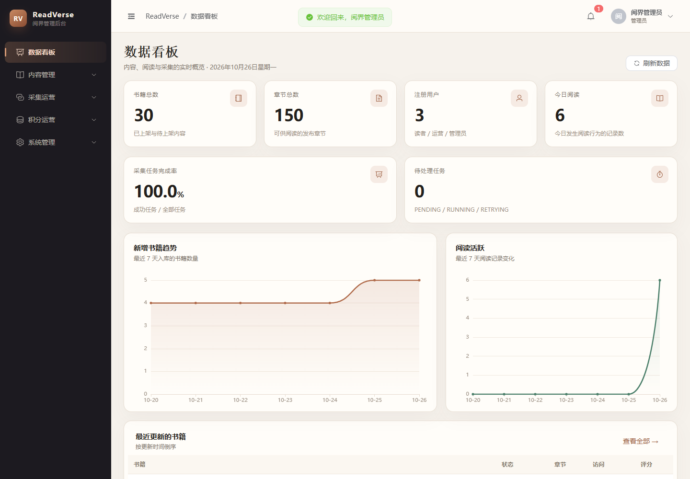
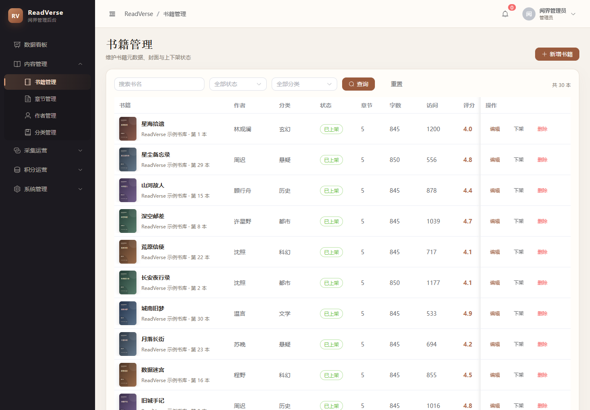
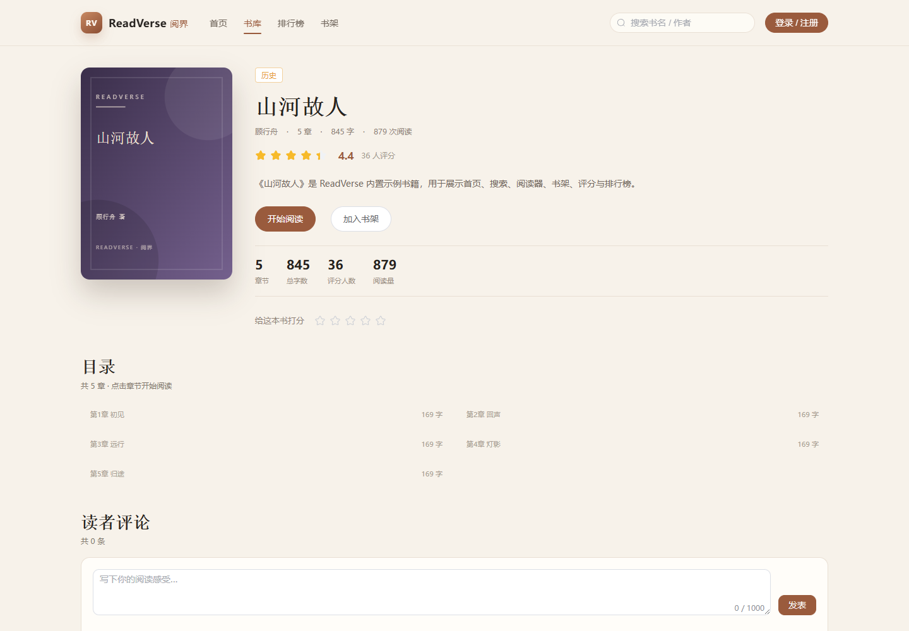
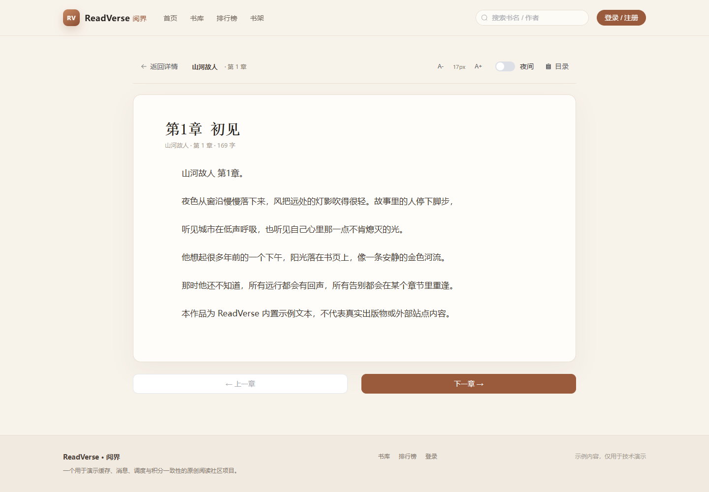
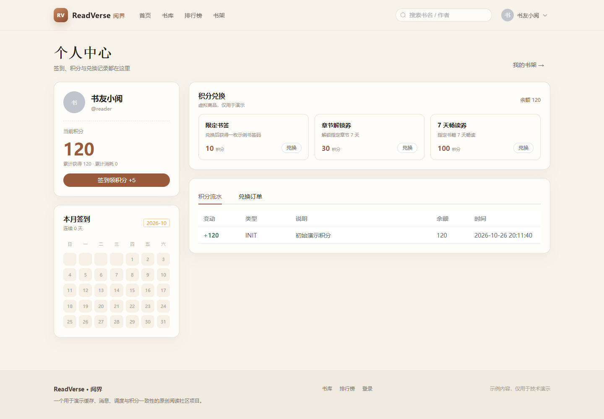

# ReadVerse · 阅界

> 一个从 0 到 1 构建的全栈阅读社区：**Spring Boot 3 + Vue 3 + MySQL + Redis**，重点展示缓存、限流、分布式锁、异步统计、示例书源同步与积分一致性。



**在线演示（Docker Desktop）**

- 管理后台：<http://localhost:8081>（`admin / Admin@123`，`operator / Operator@123`）
- 读者门户：<http://localhost:8082>（`reader / Reader@123`）
- 后端 Swagger：<http://localhost:18080/swagger-ui.html>
- 健康检查：<http://localhost:18080/actuator/health>

---

## 1. 已实现功能

| 模块 | 能力 | 状态 |
|---|---|---|
| 认证与 RBAC | 注册、登录、Refresh Token、登出白名单、角色/权限、动态菜单、按钮级权限 | ✅ |
| 内容域 | 作者/分类/书籍/章节 CRUD、上下架、封面上传、分页搜索 | ✅ |
| 阅读体验 | 首页聚合、书详情、目录、阅读器、阅读进度、书架 | ✅ |
| 互动 | 评分（一人一条可改）、评论、点赞、删除自评 | ✅ |
| 排行榜 | Redis Zset 点击量，7 日 / 30 日 / 总榜 | ✅ |
| 缓存 | Caffeine L1 + Redis L2、空值缓存、Cache-Aside、Banner 缓存 | ✅ |
| 防穿透 | Redis Bitmap 布隆过滤器，启动预热 + 每日重建 + 失效兜底 | ✅ |
| 限流 | `@RateLimit` + Redis Lua 令牌桶，章节/书详情接入，返回 429 | ✅ |
| 分布式锁 | Redisson 锁，评分聚合/榜单规则使用 | ✅ |
| 异步事件 | 统一事件体 + 本地事件总线；`rv.mq.enabled=true` 切换 RabbitMQ 监听器 | ✅（本地默认） |
| 示例书源 | Mock 书源、全量/增量/章节同步、幂等 upsert、失败重试/重放、作业日志 | ✅ |
| 积分 | 签到、积分账户/流水、商品兑换、权益、幂等键、对账 | ✅ |
| 运营看板 | 书籍/章节/用户/今日阅读、采集成功率、趋势图 | ✅ |
| 测试 | JWT 单测 3 个 + BCrypt 单测 1 个；Maven 构建通过 | ✅（基础覆盖） |

详细计划与取舍见 **[docs/ReadVerse-项目实施计划.md](docs/ReadVerse-项目实施计划.md)**，验证记录见 **[docs/verification.md](docs/verification.md)**。

---

## 2. 技术栈

| 层 | 选型 |
|---|---|
| 后端 | Spring Boot 3.5.16、JDK 17、Spring Security 6、MyBatis-Plus 3.5.18 |
| 认证 | JJWT 0.12.6，Access 30min + Refresh 7d，Redis Token 白名单 |
| 缓存 | Caffeine 3.2 + Redis 7（Docker Compose 中使用 `redis:7-alpine`） |
| 锁 / 布隆 | Redisson 3.52 + Redis Bitmap 自实现布隆 |
| 数据库 | MySQL 8.0，`schema.sql` 自动建表 + Java 初始化种子数据 |
| 消息 | Spring AMQP / RabbitMQ（可选），默认本地事件总线 |
| 调度 | Spring Scheduling 兜底；XXL-Job 接入点预留在 `rv-crawl/job` |
| 前端 | Vue 3.5、Vite 5.4、TypeScript、Element Plus 2.9、Pinia 2.3、Vue Router 4.5、Axios 1.7、ECharts 5.5 |
| 文档 | SpringDoc OpenAPI 2.8（Swagger UI）、Markdown 文档 |
| 质量 | JUnit 5、AssertJ、Playwright（系统 Chrome 截图验收） |

---

## 3. 项目结构

```text
readverse/
├── rv-common        # R<T> / PageResult / ErrorCode / BizException
├── rv-framework     # JWT / RBAC / 缓存 / 布隆 / 限流 / 锁 / MyBatis / 异常 / MQ
├── rv-system        # 用户、角色、权限、通知、审核通知监听
├── rv-content       # 作者/分类/书籍/章节/阅读/评分/评论/排行/积分/统计
├── rv-crawl         # 示例书源、任务状态机、同步、重试、作业日志、调度
├── rv-server        # 启动模块、schema.sql、种子数据、上传、OpenAPI
├── web-admin        # 管理后台（Vue3）
├── web-portal       # 读者门户（Vue3）
├── deploy           # docker-compose + MySQL 初始化脚本
├── docs             # 计划、验证记录、截图
└── tools/e2e        # Playwright 验收脚本（本地工具，不参与构建）
```

---

## 4. Docker Desktop 启动（推荐）

> 项目已提供完整 Docker 镜像与 Compose：MySQL、Redis、后端、管理端 Nginx、门户 Nginx 全部跑在 Docker Desktop 中。

### 4.1 前置条件

- 安装并启动 **Docker Desktop**，确认 `docker info` 正常返回 `Server Version`
- 不需要本机安装 JDK、Maven、MySQL、Redis、Node（镜像内已包含）
- 默认端口未被占用：`8081`、`8082`、`18080`、`13306`、`6380`

### 4.2 一键启动

```powershell
cd C:\Users\16098\Desktop\ReadVerse
powershell -ExecutionPolicy Bypass -File .\scripts\docker-start.ps1
```

首次启动时如果镜像不存在，Compose 会自动构建后端与两个前端镜像，然后启动 5 个容器并等待健康检查。  
后续日常启动直接运行同一命令，不会重复构建：

```powershell
powershell -ExecutionPolicy Bypass -File .\scripts\docker-start.ps1
```

修改了后端/前端代码后，需要显式重建：

```powershell
powershell -ExecutionPolicy Bypass -File .\scripts\docker-start.ps1 -Build
```

| 端 | 地址 | 账号 |
|---|---|---|
| 管理后台 | http://localhost:8081 | `admin / Admin@123`、`operator / Operator@123` |
| 读者门户 | http://localhost:8082 | `reader / Reader@123` |
| 后端 API | http://localhost:18080 | Swagger：`/swagger-ui.html` |
| 健康检查 | http://localhost:18080/actuator/health | 应返回 `UP` |

停止：

```powershell
powershell -ExecutionPolicy Bypass -File .\scripts\docker-stop.ps1
```

> 停止不会删除 MySQL 数据；加 `-RemoveVolumes` 才会清空数据卷（下次启动重新建表/种子）。

### 4.3 手动执行 Compose

```powershell
cd C:\Users\16098\Desktop\ReadVerse

# 构建并启动
docker compose -f deploy/docker-compose.yml up -d --build

# 查看状态（mysql/redis/backend/web-admin/web-portal 都应为 healthy）
docker compose -f deploy/docker-compose.yml ps

# 看日志
docker compose -f deploy/docker-compose.yml logs -f backend
```

停止/删除：

```powershell
docker compose -f deploy/docker-compose.yml down          # 保留数据卷
docker compose -f deploy/docker-compose.yml down -v       # 清空数据卷，谨慎
```

### 4.4 端口与数据卷

| 服务 | 宿主机端口 | 容器内端口 | 说明 |
|---|---:|---:|---|
| MySQL | 13306 | 3306 | 避免与本机 3306 冲突 |
| Redis | 6380 | 6379 | 避免与本机 6379 冲突 |
| Backend | 18080 | 8080 | 避免与已有 8080 服务冲突 |
| web-admin | 8081 | 80 | Nginx 静态资源 + `/api` 反代 |
| web-portal | 8082 | 80 | Nginx 静态资源 + `/api` 反代 |
| RabbitMQ | 5673 / 15673 | 5672 / 15672 | 仅 `mq` profile 启用 |

如需改端口：

```powershell
Copy-Item deploy\.env.example deploy\.env
# 编辑 deploy\.env 里的 MYSQL_PORT / REDIS_PORT / BACKEND_PORT / ADMIN_PORT / PORTAL_PORT
docker compose -f deploy/docker-compose.yml up -d
```

数据卷：`readverse_rv8-mysql-data`、`readverse_rv8-redis-data`、`readverse_rv8-uploads`。MySQL 初始化脚本在 `deploy/mysql/init/`，应用启动时会自动建表并写入 30 本书/150 章。

### 4.5 可选：启用 RabbitMQ

默认 `RV_MQ_ENABLED=false`，使用本地事件总线，不需要 RabbitMQ。要演示真实 broker：

```powershell
# 1. 启动 RabbitMQ（compose 中的 mq profile）
docker compose -f deploy/docker-compose.yml --profile mq up -d rabbitmq

# 2. 在 deploy\.env 增加：
#    RV_MQ_ENABLED=true
# 3. 重建 backend，让它连接 broker
docker compose -f deploy/docker-compose.yml up -d --force-recreate backend
```

RabbitMQ 管理台：<http://localhost:15673>（`rv / rv123456`）。

### 4.6 演示账号

| 账号 | 密码 | 角色 | 用途 |
|---|---|---|---|
| `admin` | `Admin@123` | 管理员 | 全部菜单、权限、系统管理 |
| `operator` | `Operator@123` | 运营 | 内容、采集、积分，无系统管理 |
| `reader` | `Reader@123` | 读者 | 门户阅读、书架、评分、签到、兑换 |

### 4.7 没有 Docker 时的本地备用

如果你确实无法运行 Docker Desktop，可使用本地脚本，详见 **[docs/local-start.md](docs/local-start.md)**。

---
## 5. 关键设计

### 5.1 JWT + RBAC

- Access Token 30 分钟，Refresh Token 7 天；JJWT 0.12 API。
- JWT 只放 `userId`、`username`、`jti`；登录用户信息（角色 + 权限）存 Redis `rv:auth:token:{jti}`，登出即失效。
- `@PreAuthorize("hasAuthority('content:book:edit')")` 做按钮/接口级鉴权；前端 `v-permission` 风格由 `hasPerm()` 控制按钮显隐。
- 动态菜单：`/api/admin/menus` 按当前用户权限过滤 `MENU` 节点，前端侧边栏由后端菜单驱动。

### 5.2 二级缓存 + 布隆 + 限流

- 章节详情：Caffeine L1（60s）→ Redis L2（30min ± 随机）→ MySQL；更新后删 L2、删 L1，并延迟双删。
- 布隆：Redis Bitmap + MD5 四路哈希，启动预热 150 个章节；Redis 被清空时 fail-open，避免误杀。
- `@RateLimit`：Redis Lua 令牌桶，按 IP / USER / GLOBAL 维度；章节 120 req/s、书详情 200 req/s；超限返回 42901。
- 实测 400 个并发章节请求：200 × 144、429 × 256；冷读 `cached=false`，二次读 `cached=true`（见 `docs/verification.md`）。

### 5.3 异步统计与审核通知

- 统一事件体 `DomainEvent(eventId, type, bizId, occurredAt, payload)`。
- 本地模式：`ApplicationEventPublisher`；RabbitMQ 模式：`RabbitTemplate` + `@RabbitListener`（同一套 Handler）。
- 已接入两条链路：
  1. 书籍审核结果 → 通知管理员（`BOOK_AUDIT_PASSED/REJECTED → sys_notify`）。
  2. 章节阅读行为 → 日统计（`CHAPTER_READ → stat_daily_book/stat_daily_platform`）。
- 配置 `rv.mq.enabled` 一键切换；默认本地模式无需中间件即可演示。

### 5.4 示例书源同步

- 内置 `MockSourceAdapter`：10 本示例书、50 章，**不访问真实站点**。
- 唯一键幂等：`crawl_book_map(source_id, external_book_id)`、`content_chapter(book_id, chapter_no)`。
- 任务状态：`PENDING → RUNNING → SUCCESS/FAILED`；管理端可重放。
- 全量任务重复执行 3 次不新增书籍/章节；每次执行写 `sys_job_log`。

### 5.5 积分一致性

- `reader_points_account` + `reader_points_log`；流水是事实来源。
- 变更走“条件更新 + version 乐观锁 + 重试”，扣减时校验 `balance >= amount`。
- 签到：`reader_sign_in(user_id, sign_date)` 唯一键防重，Redis Bitmap 仅作展示加速。
- 兑换：库存原子扣减、积分扣减、订单、权益同一事务；支持 `Idempotency-Key`，重复请求返回同一订单。
- 对账接口：`POST /api/admin/points/reconcile`，当前演示数据差异为 0。

---

## 6. 主要接口

### 门户

| 方法 | 路径 | 说明 |
|---|---|---|
| GET | `/api/portal/home` | 首页聚合 |
| GET | `/api/portal/books` | 书库分页/分类/排序 |
| GET | `/api/portal/books/{id}` | 书详情（限流） |
| GET | `/api/portal/books/{id}/chapters` | 目录 |
| GET | `/api/portal/books/{id}/cover` | 动态 SVG 封面 |
| GET | `/api/portal/chapters/{id}` | 章节正文（限流、缓存、VIP 校验） |
| GET | `/api/portal/rankings` | 7d/30d/all |
| GET/POST/DELETE | `/api/portal/bookshelf` | 书架 |
| GET/PUT | `/api/portal/read-record` | 阅读进度 |
| POST | `/api/portal/ratings/{bookId}` | 评分 |
| GET/POST | `/api/portal/comments` | 评论 |
| POST | `/api/portal/sign-in` | 签到 |
| GET | `/api/portal/sign-in/month` | 月签到 |
| GET | `/api/portal/points/*` | 账户/流水/商品/订单 |
| POST | `/api/portal/points/exchange` | 兑换 |

### 管理后台

| 方法 | 路径 | 说明 |
|---|---|---|
| POST | `/api/auth/login` | 登录 |
| GET | `/api/admin/menus` | 动态菜单 |
| GET | `/api/admin/dashboard/*` | 看板 |
| GET/POST/PUT/DELETE | `/api/admin/books` | 书籍 |
| PUT | `/api/admin/books/{id}/publish` | 上下架 |
| GET/POST/PUT/DELETE | `/api/admin/chapters` | 章节 |
| GET/POST/PUT/DELETE | `/api/admin/authors` | 作者 |
| GET/POST/PUT/DELETE | `/api/admin/categories` | 分类 |
| GET/POST | `/api/admin/crawl/sources` | 书源 |
| POST | `/api/admin/crawl/tasks/trigger` | 触发同步 |
| POST | `/api/admin/crawl/tasks/{id}/retry` | 重放 |
| GET/POST/PUT/DELETE | `/api/admin/points/goods` | 积分商品 |
| GET | `/api/admin/points/orders` | 兑换订单 |
| POST | `/api/admin/points/reconcile` | 对账 |

完整 OpenAPI 见 `http://localhost:18080/swagger-ui.html`。

---

## 7. 验证

```bash
# Docker 容器状态（5 个服务都应为 healthy）
docker compose -f deploy/docker-compose.yml ps

# 健康检查
curl http://localhost:18080/actuator/health

# 浏览器验收（Docker 端口）
$env:RV_ADMIN_URL='http://localhost:8081'
$env:RV_PORTAL_URL='http://localhost:8082'
$env:RV_API_URL='http://localhost:18080'
node tools/e2e/verify.mjs
```

如需在宿主机执行后端/前端构建（非 Docker）：

```bash
mvn -B test
mvn -B -DskipTests package
cd web-admin && npm run build
cd ../web-portal && npm run build
```

验证结果、接口实测数字与截图见 **[docs/verification.md](docs/verification.md)**。Docker 部署细节见 **[docs/docker-deployment.md](docs/docker-deployment.md)**。

| 截图 | 说明 |
|---|---|
|  | 数据看板 |
|  | 书籍 CRUD 与封面 |
|  | 阅读社区首页 |
|  | 书籍详情与目录 |
|  | 章节阅读器 |
|  | 签到、积分、兑换 |

---

## 8. 文档

- [项目实施计划（解析 + 8 周路线）](docs/ReadVerse-项目实施计划.md)
- [Docker Desktop 部署说明](docs/docker-deployment.md)
- [无 Docker 时的本地备用启动](docs/local-start.md)
- [验收记录](docs/verification.md)
- [截图目录](docs/screenshots)

---

> 所有书籍/章节内容均为内置示例文本，不抓取真实站点；项目仅用于技术学习与作品展示。

