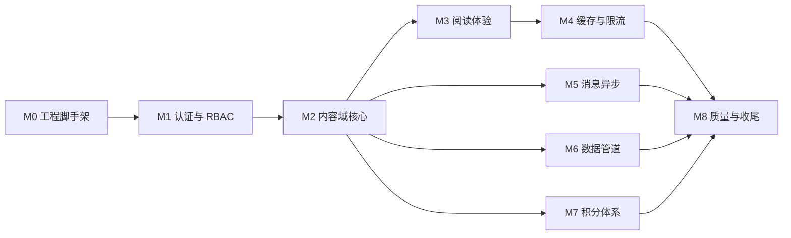
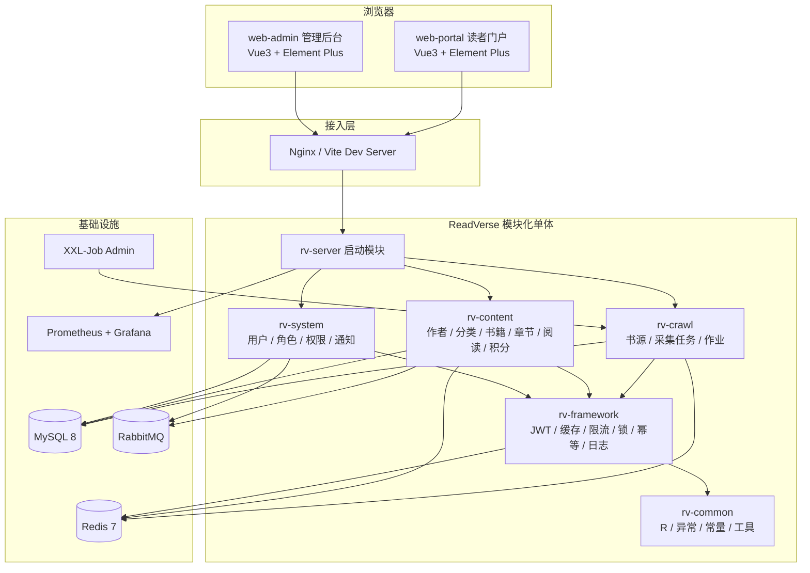
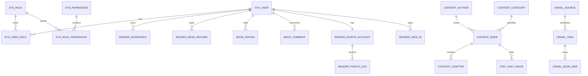
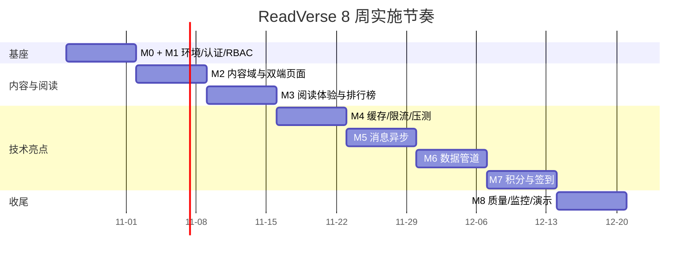

# ReadVerse（阅界）项目实施计划

> 版本：v1.0  
> 生成日期：2026-10-26  
> 基线文档：《ReadVerse-阅界阅读社区-原创项目计划.md》  
> 用途：个人全栈作品集 / Java 后端偏重岗位求职项目  
> 结论：项目可行，但不能按“8 个里程碑全部做完”直接开工；必须先定范围、补设计缺口、打通本机环境。

---

## 目录

- [0. 结论先行](#0-结论先行)
- [1. 原计划解析](#1-原计划解析)
- [2. 环境可行性](#2-环境可行性)
- [3. 范围与裁剪](#3-范围与裁剪)
- [4. 目标架构](#4-目标架构)
- [5. 数据模型](#5-数据模型)
- [6. 接口与权限](#6-接口与权限)
- [7. 实施路线图](#7-实施路线图)
- [8. 测试与质量](#8-测试与质量)
- [9. 风险登记册](#9-风险登记册)
- [10. 交付物与验收](#10-交付物与验收)
- [11. 下一步](#11-下一步)
- [附录](#附录)

---

## 0. 结论先行

### 0.1 一页结论

| 维度 | 结论 |
|---|---|
| 项目本质 | 以“阅读社区”为业务外壳，承载 **RBAC、缓存、消息、调度、积分一致性、工程化** 六类后端亮点 |
| 目标岗位 | Java 后端偏重的全栈工程师；面试叙事比页面数量更重要 |
| 原计划状态 | 是“目标形态 + 里程碑清单”，不是可直接执行的详细设计；缺少约 12 张表、若干接口和验收命令 |
| 推荐范围 | **P0：M0–M4 必做；P1：M5 一条链路、M6 示例源同步、M7 签到/积分；P2 视时间追加** |
| 推荐周期 | 8 周（2026-10-26 → 2026-12-20），约 **190 小时，平均每周 24 小时** |
| 若每周只有 12–15 小时 | 改为 12–14 周，或只做 P0（M0–M4），不要硬撑全量 |
| 当前最大阻塞 | Maven 未安装、JAVA_HOME 指向 JDK 8、Docker 引擎未启动、Redis/RabbitMQ 未安装 |
| 当前最大风险 | 范围蔓延；基础设施调试吃掉前两周；前端页面打磨挤占后端亮点时间 |
| 第一优先级 | Day 0 打通 JDK 17 + Maven + Docker + MySQL；30 分钟内 Docker 起不来就立即切备用方案 |
| 最终交付 | 可运行的双端系统 + 初始化 SQL + 架构/接口/压测/测试文档 + 5 分钟演示视频 + 简历 bullet |

### 0.2 推荐执行方案

**先做“能跑通、能讲清楚”的标准线，再补“好看”的加分线。**

1. **第 1 周**：环境 + M0 + M1 后端，先让 `/actuator/health` 和三角色登录跑通。
2. **第 2–3 周**：M2 内容域 + 管理端四模块 + 门户首页/详情，形成第一条业务闭环。
3. **第 4 周**：M3 阅读器、进度、书架、评分评论、排行榜，形成完整读者旅程。
4. **第 5 周**：M4 二级缓存、布隆过滤器、限流、分布式锁 + JMeter 报告，产出第一组简历数字。
5. **第 6 周**：M5 一条 MQ 链路 + M6 书源/任务/全量增量同步，产出异步与幂等亮点。
6. **第 7 周**：M6 收尾 + M7 签到/积分/兑换/对账，产出交易一致性亮点。
7. **第 8 周**：M8 测试、监控、看板、文档、演示视频、部署与简历定稿。

### 0.3 需要你拍板的 4 件事

| 编号 | 决策 | 选项 | 推荐 |
|---|---|---|---|
| D1 | 每周可投入时间 | 24h / 16h / 8h | 24h，按 8 周推进 |
| D2 | 交付范围 | P0 / P0+P1 / 全量 M0–M8 | P0+P1，M8 精简 |
| D3 | 基础设施 | Docker 全量 / 本地 MySQL + Docker Redis / 零依赖演示 | Docker 全量，失败则切本地混合 |
| D4 | 前端风格 | Element Plus 默认 / 自定义阅读主题 | 管理端默认，门户做轻量阅读主题 |

> 这 4 项确认后，Day 1 就可以直接开始 M0，不需要再改计划骨架。

---

## 1. 原计划解析

### 1.1 一句话读懂原计划

ReadVerse 是一个**在线阅读社区**：读者浏览、搜索、阅读、评分、签到、攒积分；运营在后台维护书籍/章节/作者/分类，管理示例书源与采集任务；管理员通过 RBAC 管理人与权限。

**原文结构速览：**

| 原文章节 | 内容 | 对本计划的意义 |
|---|---|---|
| §0 计划怎么用 | 里程碑制 + 三档裁剪线 | 决定“先做哪条线、何时止损” |
| §1 项目定位 | 阅读社区 + 四类工程问题 | 面试叙事的主线 |
| §2 需求范围 | 三类角色、8 个里程碑功能 | 功能地图与验收范围 |
| §3 技术选型 | Spring Boot 3 + Vue3 + Redis + MQ + XXL-Job | 锁定版本与替代方案 |
| §4 系统架构 | 5 个后端模块 + 双前端 + 基础设施 | 增加 `rv-server`，明确依赖方向 |
| §5 数据库 | 文中称 12 张核心表 | 实际 17 张；本计划补到 29 张 |
| §6 里程碑 | M0–M8 任务清单 | 转成 8 周可执行路线 |
| §7 执行模板 | 输入/任务/约束/验收/提交 | 每周 Gate 与 PR 描述 |
| §8 简历映射 | 9 条 bullet 示例 | 交付时要填真实数字 |
| §9 常用命令 | Maven/Docker/npm/JMeter | 附录 A 的底稿 |
| §10 版本记录 | v1.0 | 本计划的基线 |

它真正要证明的不是“会写 CRUD”，而是以下四条技术主线：

| 主线 | 业务切入点 | 要证明的能力 |
|---|---|---|
| 高并发读 | 书籍详情、章节正文、首页、排行榜 | 缓存、防穿透、限流、热点 key、压测 |
| 异步解耦 | 审核通知、阅读行为埋点、统计 | RabbitMQ、可靠投递、幂等、死信 |
| 数据管道 | 示例书源、全量/增量同步、失败重放 | 调度、游标、upsert 幂等、状态机 |
| 交易一致性 | 签到、积分流水、兑换、对账 | 乐观锁、唯一键、事务、对账 |

### 1.2 项目为什么成立（面试叙事）

- 阅读场景天然 **读多写少**：一本书一个章节会被反复读取，适合讲缓存命中率、QPS 提升、P99 下降。
- 书籍/章节来自外部源：天然有 **增量同步、重复执行、失败重试、幂等** 的工程问题。
- 运营动作需要通知、行为需要统计：天然适合 **消息异步化**，可以讲削峰、解耦、最终一致性。
- 积分是虚拟资产：天然有 **并发扣减、重复发放、流水对账**，比纯 CRUD 高一档。
- 双端（门户 + 管理后台）能证明全栈交付能力，但**后端深度才是主叙事**。

### 1.3 角色与功能地图

| 能力域 | 读者（门户） | 运营（后台） | 管理员（后台） |
|---|---|---|---|
| 认证 | 注册、登录、登出、改密 | 登录、登出 | 登录、登出 |
| 内容 | 首页、分类、搜索、书详情、章节阅读 | 作者/分类/书籍/章节 CRUD、上下架、审核 | 同运营 + 权限分配 |
| 阅读 | 书架、阅读进度、评分、评论、排行榜 | 评论管理、评分查看 | 同运营 |
| 积分 | 签到、积分流水、兑换、权益 | 积分规则、商品、订单、对账 | 同运营 |
| 采集 | — | 书源、任务、重试、重放、作业日志 | 同运营 |
| 系统 | 个人中心、通知 | 用户查看、通知、看板 | 用户/角色/权限、操作日志、看板 |

### 1.4 里程碑依赖关系



关键判断：

- **M1 是所有后台接口的前置**，不能跳过。
- **M2 是业务底座**，M3–M7 都依赖书籍/章节/用户。
- **M4 必须建立在 M2/M3 的真实读接口上**，否则压测没有意义。
- **M5、M6、M7 可以并行设计，但建议串行实现**，一个人同一时间只保留一个“深水区”。
- **M8 不是最后才做**：测试、监控埋点从 M1 就要开始，最后一周只做收口。

### 1.5 技术栈逐项评估

| 层 | 原计划 | 本计划决策 | 说明 |
|---|---|---|---|
| JDK | 17 | **17** | 本机已有 `C:\Program Files\Java\jdk-17`（17.0.12）；不要用默认的 JDK 8 |
| 后端 | Spring Boot 3.5.x | **3.5.x，创建时锁定补丁版本** | 与 JDK 17 匹配；本机 `.m2` 有 3.2.5 缓存，可作依赖解析失败时的降级备选 |
| ORM | MyBatis-Plus 3.5 | **保留，3.5.9+** | 分页、乐观锁、逻辑删除、自动填充都要用上 |
| 安全 | Spring Security + JWT | **保留** | JJWT 0.12.x；Access 30min + Refresh 7d；Redis 白名单 |
| 缓存 | Redis 7 + Caffeine + Redisson | **保留** | Caffeine 做 L1，Redis 做 L2，Redisson 做锁与布隆 |
| 消息 | RabbitMQ | **保留；增加本地事件总线开关** | 无 Broker 时也能启动演示，但不作为最终演示形态 |
| 调度 | XXL-Job 2.4 | **保留；增加 Spring Scheduling 兜底** | xxl-job-admin 放 compose；无 admin 时用 `@Scheduled` 跑通业务 |
| 数据库 | MySQL 8 | **保留** | 本机 MySQL 8.0.46 正在运行，可用 root/123456 做本地初始化 |
| 管理端 | Vue3 + Vite + TS + Element Plus + Pinia + Router + Axios + ECharts | **保留** | 建议锁定 Vue 3.5 / Vite 5.4 / Element Plus 2.9 / Pinia 2.3 |
| 门户 | Vue3 + Vite + TS + Element Plus + Axios | **保留** | 与后台同栈，但视觉上做阅读主题，避免“两个后台” |
| 部署 | Docker Compose | **保留，分 profile** | `infra` / `app` / `monitor` 三组，避免一上来全量拉起 |
| 质量 | JUnit 5 + Mockito + JMeter + Actuator + Prometheus + Grafana + GitHub Actions | **保留，按阶段启用** | M8 只做“能演示、能说清”的最小闭环 |

### 1.6 原计划的 10 个缺口（必须补）

原计划是很好的“目标清单”，但直接照着写会在第 2 周开始返工。以下缺口需要在开工前定版：

| # | 缺口 | 影响 | 本计划处理 |
|---|---|---|---|
| 1 | **没有启动模块** | 5 个业务模块没有 `main` 类，无法打包运行 | 增加 `rv-server` 启动模块，聚合所有模块与配置 |
| 2 | **表数量对不上** | 文中说“12 张核心表”，实际列了 **17 张物理表**（13 行，含合并写法） | 本计划明确到 **29 张表**，按里程碑标注 P0/P1/P2 |
| 3 | **缺少书架表** | M2 有书架功能，但没有 `reader_bookshelf` | 增加 `reader_bookshelf` |
| 4 | **缺少评分/评论表** | M3 有评分评论，但没有表 | 增加 `book_rating`、`book_comment` |
| 5 | **缺少兑换/权益表** | M7 兑换 VIP 章节券，但没有商品、订单、权益表 | 增加 `points_goods`、`points_exchange_order`、`reader_entitlement` |
| 6 | **缺少统计/幂等表** | M5 埋点统计、M6 作业日志、M8 看板、MQ 去重都没有落点 | 增加 `stat_daily_book`、`stat_daily_platform`、`sys_job_log`、`msg_consume_log` |
| 7 | **`category_id` 与 `book_category_rel` 语义冲突** | 一本书到底一个分类还是多个分类？查询会分叉 | MVP 只用 `category_id` 作为主分类；`book_category_rel` 标记 P2，不启用 |
| 8 | **中文搜索没定实现** | MySQL 默认全文索引对中文分词无效 | 使用 `FULLTEXT ... WITH PARSER ngram`；不可用时降级 `LIKE`，ES 不做 |
| 9 | **封面/文件上传没方案** | 书籍封面上传无接口、无存储路径 | M2 增加本地 `/uploads` + 静态映射；后续可换 OSS |
| 10 | **DB 与 MQ 一致性没定义** | 审核结果落库成功、消息发送失败会丢通知 | 先做“事务提交后发送 + 失败记录 + 补偿任务”；P1 可升级 Outbox |

另外三个小问题：

- **验收标准不可执行**：原文多为“正确”“跑通”，本计划改成命令 + 量化指标。
- **XXL-Job 的 admin 依赖没进启动路径**：需要 `xxl_job` 库、admin 容器、执行器注册地址。
- **M2 验收只提管理端 4 个模块**：但 M2 还包括门户首页/详情，验收要覆盖双端。

### 1.7 建议保留并强化的 4 条技术主线

1. **章节二级缓存 + 布隆 + 限流**：这是最容易量化、最适合写简历的一条线。必须产出“优化前/后 QPS、P99、命中率”表格。
2. **RabbitMQ 审核通知链路**：先做一条，做扎实（confirm、手动 ACK、重试、死信、幂等），比三条半成品强。
3. **示例书源增量同步**：只做 mock/本地示例源，强调游标、唯一键、upsert、失败重放，不做真实侵权采集。
4. **签到 + 积分流水 + 对账**：用唯一键 + 乐观锁 + 事务，压测 100 并发，证明不重复发放、不出现负余额。

---

## 2. 环境可行性

### 2.1 本机盘点（2026-10-26 实测）

| 项 | 现状 | 影响 | 处理建议 |
|---|---|---|---|
| 操作系统 | Windows | 路径、脚本、Docker 需按 Windows 处理 | PowerShell / Git Bash 均可 |
| JDK 17 | `C:\Program Files\Java\jdk-17`，17.0.12 | 可用 | 项目固定 JDK 17 |
| JDK 21 | `C:\Program Files\Java\jdk-21`，21.0.9 | 可用，但项目不依赖 | 不作为主版本 |
| `JAVA_HOME` | 指向 `jdk1.8.0_202` | **Maven 会按 JDK 8 编译，直接失败** | 每个终端显式设置 JDK 17，或改系统环境变量 |
| Maven | **未安装**，无 `mvnw` | 无法构建多模块工程 | 安装 Maven 3.9.x + 提交 Maven Wrapper |
| Docker | Docker Desktop 已安装，**引擎未启动**；WSL 查询在当前权限下报 `ACCESS_DENIED` | Redis/RabbitMQ/XXL-Job 无法拉起 | Day 0 先尝试启动；30 分钟不通立即切方案 B/C |
| MySQL | MySQL 8.0.46 服务运行中，`root/123456` 可登录 | 可直接建库 | 建 `readverse` 库 + 专用账号；不要长期用 root |
| Redis | **未安装**，无 `redis-cli` | M4/M7 依赖 | Docker Redis；失败则 Memurai/Windows Redis 端口 |
| RabbitMQ | **未安装** | M5 依赖 | Docker；失败则本地事件总线兜底 |
| Node | v22.21.1 | 可用 | 前端用 Node 22 |
| npm | 10.9.4 | 可用；PowerShell 执行策略会拦 `npm.ps1` | 用 `npm.cmd` 或 `cmd /c npm` |
| pnpm | **未安装**；corepack 0.34.0 可用 | 计划里写的是 npm，不强制 pnpm | 需要时 `corepack enable` |
| Git | 2.53.0，已配置用户名/邮箱 | 可用 | 先 `git init`，远程仓库后建 |
| 网络 | 当前受限终端访问 HTTPS 会报 schannel 证书错误 | 依赖下载可能失败 | 在允许网络的环境/提权终端执行下载；或预先缓存依赖 |
| 磁盘 | 当前权限下无法读取 | Docker 镜像 + node_modules + Maven 仓库约需 10–20GB | 开工前在普通终端确认剩余空间 ≥20GB |

### 2.2 三种运行方案

| 方案 | 组成 | 优点 | 缺点 | 适用 |
|---|---|---|---|---|
| **A. Docker 全量（推荐）** | compose 起 MySQL 8 + Redis 7 + RabbitMQ + xxl-job-admin；后端/前端本机跑 | 最贴近计划；环境隔离；一键重建 | Docker/WSL 若不可用会卡住；镜像约 1.5GB | 正式开发与演示 |
| **B. 本地混合** | 本机 MySQL 8 + Docker Redis/RabbitMQ；XXL-Job 用 Spring Scheduling 兜底 | 复用已运行的 MySQL；少一个容器 | 仍依赖 Docker 跑 Redis/RabbitMQ | Docker 能跑但不想全量容器化 |
| **C. 零依赖演示** | H2（MySQL 模式）+ Caffeine 本地缓存 + Spring Event + `@Scheduled` | 任何机器 `java -jar` 就能启动；CI 友好 | 失去 Redis/RabbitMQ 亮点，不能作为最终简历演示 | 应急、单测、快速给面试官看页面 |

**决策规则：**

- Day 0 先试 A；`docker info` 30 分钟内不通，切 B；B 仍不通，切 C 保证项目能跑，但把 Redis/MQ 相关代码保留为可配置开关，后续补真实环境。
- 不允许“为了等 Docker 停三天”。项目主线是代码与文档，基础设施可以后补。

### 2.3 Day 0 环境清单

按顺序执行，全部通过才进入 M0：

- [ ] 终端设置 JDK 17，`java -version` 显示 17.x。
- [ ] 安装 Maven 3.9.x，`mvn -v` 显示 Java 17；项目提交 `mvnw`/`mvnw.cmd`。
- [ ] 启动 Docker Desktop，`docker info` 正常返回 Server Version。
- [ ] `docker compose -f deploy/docker-compose.yml up -d mysql redis rabbitmq` 成功。
- [ ] MySQL 建库：`readverse`，字符集 `utf8mb4`，排序 `utf8mb4_0900_ai_ci`。
- [ ] `docker exec rv-redis redis-cli ping` 返回 `PONG`。
- [ ] RabbitMQ 管理台 `http://localhost:15672` 可登录。
- [ ] `http://localhost:8858/xxl-job-admin` 可打开（若启用 XXL-Job）。
- [ ] `git init`，提交 `.gitignore` 与 README 骨架。
- [ ] M0 完成后，两个前端各跑一次 `npm run dev`，页面可打开。

### 2.4 环境验收命令

```powershell
# JDK 17（当前终端生效）
$env:JAVA_HOME = 'C:\Program Files\Java\jdk-17'
$env:Path = "$env:JAVA_HOME\bin;$env:Path"
java -version
mvn -v

# Docker
docker info
docker compose -f deploy/docker-compose.yml ps

# MySQL
mysql -u root -p123456 -e "SHOW DATABASES LIKE 'readverse';"

# Redis
docker exec -it rv-redis redis-cli ping

# RabbitMQ
curl.exe -u rv:rv123456 http://localhost:15672/api/overview
```

> 说明：密码只用于本地开发，最终写入 `.env`，`.env` 不进 Git；README 只给示例值。

---

## 3. 范围与裁剪

### 3.1 P0 / P1 / P2 功能矩阵

| 优先级 | 范围 | 具体内容 | 目的 |
|---|---|---|---|
| **P0 必须** | M0–M4 | 脚手架、认证/RBAC、内容域、阅读器、书架、评分评论、排行榜、二级缓存、布隆、限流、压测 | 完整可演示的全栈项目 + 第一组硬指标 |
| **P1 应该** | M5–M7 | 一条 MQ 审核通知主链、示例书源全量/增量同步、签到、积分流水、兑换、对账；阅读埋点统计作为第二条链路，时间允许再做 | 异步、调度、交易一致性三个差异化亮点 |
| **P2 可选** | M8 进阶 | 三条 MQ 链路、Outbox、Grafana 全量面板、公开演示、Playwright E2E、ES 搜索 | 竞争力加分，不阻塞投递 |

> 与原文三档的对应：**P0 ≈ MVP 线**；**P1 ≈ 标准线 + 提前做 M7**（积分一致性是差异化亮点，所以不放到最后）；**P2 ≈ 加分线的工程化与演示增强**。这是一次有意识的“提前”，不是范围失控；如果 W7 吃紧，按 3.4 砍兑换、保签到+流水+对账。

### 3.2 推荐范围与工时

| 里程碑 | 内容 | 估算工时 | 累计 |
|---|---|---:|---:|
| M0 | 环境、脚手架、compose、CI 骨架 | 10h | 10h |
| M1 | JWT + RBAC + 动态菜单 + 管理端登录 | 22h | 32h |
| M2 | 作者/分类/书籍/章节 + 上传 + 搜索 + 管理端四模块 + 门户首页/详情 | 36h | 68h |
| M3 | 阅读器、进度、书架、评分评论、排行榜 | 24h | 92h |
| M4 | Caffeine + Redis + Bloom + `@RateLimit` + Redisson + JMeter | 20h | 112h |
| M5 | MQ 事件体、审核通知主链、死信、幂等（阅读埋点作为 P2 第二条链） | 12h | 124h |
| M6 | 示例书源、全量/增量/章节同步、重试、重放、作业日志 | 18h | 142h |
| M7 | 签到、积分账户/流水、商品、兑换、权益、对账 | 18h | 160h |
| M8 | 单测/集成测试、CI、Prometheus/Grafana、慢 SQL、看板 | 18h | 178h |
| 文档/演示 | README、架构/接口/压测/测试文档、视频、简历 | 12h | **190h** |

> 这是“AI 辅助编码 + 自己验收”的估算。纯手写请按 1.5–2 倍时间准备。  
> 190h ÷ 8 周 ≈ 24h/周；如果每周只有 12h，请延长到 14–16 周，或砍掉 P1。

### 3.3 明确不做

- **不做真实侵权采集**：只用本地 mock 书源或公版/示例文本；采集适配器只保留接口与 mock 实现。
- **不接真实支付**：积分兑换只做虚拟商品与权益发放。
- **不引入 ES**：MySQL ngram 全文索引足够 MVP；ES 作为 P2 文档说明。
- **不拆微服务**：模块化单体是正确选择；简历上写“模块化单体 + 领域分包”，不要硬说微服务。
- **不做复杂推荐算法**：排行榜用点击量 zset，不做协同过滤。
- **不做完整 App/小程序**：双端 Web 已足够。
- **不追求 100% 覆盖率**：核心包 60% 即可，优先覆盖认证、缓存、限流、积分。

### 3.4 止损线

| 时间点 | 必须达到 | 未达到怎么办 |
|---|---|---|
| W1 结束 | 环境通、健康检查 200、三角色能登录、菜单不同 | 暂停业务，W2 只补 M0/M1；仍不通则切方案 C |
| W3 结束 | M2 管理端四模块 + 门户首页/详情可用 | 砍 M2 非核心字段，优先书籍/章节；作者审核简化 |
| W4 结束 | 读者旅程“浏览→搜索→阅读→评分”闭环 | 砍排行榜/评论点赞，保阅读与评分 |
| W5 结束 | 缓存命中率与 QPS 有数字 | 砍 Bloom，保 Cache-Aside + 限流；压测必须做 |
| W6 结束 | 一条 MQ 链路 + 全量/增量任务可跑 | 砍章节同步，保全量+增量；XXL-Job 切 Spring Scheduling |
| W7 结束 | 签到/积分/兑换主链路 + 对账 | 砍兑换，保签到+流水+乐观锁 |
| W8 结束 | 可演示、文档齐、CI 绿 | 砍 Grafana 全量面板，保 Actuator + Prometheus 指标 + 截图 |

---

## 4. 目标架构

### 4.1 系统拓扑



### 4.2 后端模块与依赖规则

```
readverse/
├── pom.xml                     # parent：版本管理、插件、模块聚合
├── rv-common/                  # 无业务依赖
├── rv-framework/               # 依赖 common；安全、缓存、限流、锁、幂等、日志
├── rv-system/                  # 依赖 framework；用户、角色、权限、通知
├── rv-content/                 # 依赖 framework + system；内容、阅读、积分
├── rv-crawl/                   # 依赖 framework + content；书源、任务、作业
├── rv-server/                  # 依赖全部；启动类、配置、Controller 聚合（也可放各模块）
├── web-admin/
├── web-portal/
├── deploy/
└── docs/
```

**依赖规则（必须遵守）：**

1. `rv-common` 不依赖任何业务模块。
2. `rv-framework` 只依赖 `rv-common`，不反向依赖业务。
3. `rv-system` 不依赖 `rv-content`；需要用户上下文时从 `rv-framework` 的 `SecurityUtils` 取。
4. `rv-content` 可以依赖 `rv-system`（发通知、查用户），但不要反向。
5. `rv-crawl` 依赖 `rv-content` 的 `BookService` / `ChapterService` 接口。
6. `rv-server` 是唯一启动模块；业务模块不要写 `main`。
7. 跨域通知优先用领域事件/MQ，避免模块间直接事务耦合。

### 4.3 前端工程

| 项 | web-admin | web-portal |
|---|---|---|
| 定位 | 运营/管理员后台 | 读者门户 |
| 页面数 | 约 16–18 个路由 | 约 9–10 个路由 |
| 核心能力 | 登录、动态菜单、按钮权限、CRUD 表格/表单、上传、ECharts 看板 | 首页、分类、搜索、书详情、阅读器、书架、评分、签到、个人中心 |
| 状态 | Pinia（user、permission、app） | Pinia（user、reader、bookshelf） |
| 请求 | Axios 实例 + 拦截器 + 401 刷新队列 | 同上，读接口可加本地缓存 |
| UI | Element Plus + 自定义布局 | Element Plus + 阅读主题变量 |
| 工程 | Vite + TS + ESLint + Prettier | 同左 |

**建议锁定版本**（与本机已有项目一致，降低踩坑）：

- Vue 3.5.x、Vite 5.4.x、TypeScript 5.6.x
- Element Plus 2.9.x、`@element-plus/icons-vue` 2.3.x
- Pinia 2.3.x、Vue Router 4.5.x、Axios 1.7.x、ECharts 5.5.x
- `unplugin-auto-import`、`unplugin-vue-components`（可选，减少样板）
- 动态路由组件映射用 `import.meta.glob('/src/views/**/*.vue')`，不要用 `eval` 或后端返回任意路径直接 import。

### 4.4 目录结构（目标形态）

```
readverse/
├── pom.xml
├── mvnw / mvnw.cmd
├── .gitignore
├── .env.example
├── README.md
├── rv-common/
│   └── src/main/java/com/readverse/common/
│       ├── result/R.java, PageResult.java
│       ├── exception/BizException.java, ErrorCode.java
│       ├── constant/...
│       └── util/...
├── rv-framework/
│   └── src/main/java/com/readverse/framework/
│       ├── security/  JwtService, JwtAuthenticationFilter, SecurityConfig, LoginUser
│       ├── cache/     CacheKeys, ChapterCacheService, BloomFilterService
│       ├── ratelimit/ @RateLimit, RateLimitAspect, TokenBucketScript
│       ├── lock/      DistributedLock
│       ├── idempotent/ @Idempotent, IdempotentAspect
│       ├── mybatis/   MybatisPlusConfig, MetaObjectHandler, SlowSqlInterceptor
│       └── web/       GlobalExceptionHandler, CorsConfig, JacksonConfig
├── rv-system/
│   └── src/main/java/com/readverse/system/
│       ├── controller/ AuthController, UserController, RoleController, PermissionController, NotifyController
│       ├── service/    ...
│       ├── mapper/     ...
│       ├── entity/     SysUser, SysRole, SysPermission, SysNotify ...
│       └── dto/vo/     ...
├── rv-content/
│   └── src/main/java/com/readverse/content/
│       ├── controller/ admin/..., portal/...
│       ├── service/    BookService, ChapterService, ReadingService, RankService, PointsService ...
│       ├── mapper/     ...
│       ├── entity/     ...
│       └── dto/vo/     ...
├── rv-crawl/
│   └── src/main/java/com/readverse/crawl/
│       ├── controller/ CrawlSourceController, CrawlTaskController
│       ├── service/    CrawlService, CrawlTaskService
│       ├── adapter/    CrawlSourceAdapter, MockSourceAdapter
│       ├── job/        FullSyncJob, IncrSyncJob, ChapterSyncJob
│       └── entity/     ...
├── rv-server/
│   └── src/main/
│       ├── java/com/readverse/ReadVerseApplication.java
│       └── resources/application.yml, application-dev.yml, application-prod.yml, db/migration/
├── web-admin/
│   ├── src/api/ src/router/ src/stores/ src/layout/ src/views/ src/components/ src/directives/
│   └── vite.config.ts, .env.development
├── web-portal/
│   ├── src/api/ src/router/ src/stores/ src/views/ src/components/ src/styles/
│   └── vite.config.ts, .env.development
├── deploy/
│   ├── docker-compose.yml
│   ├── mysql/init/01-schema.sql, 02-seed.sql
│   ├── nginx/nginx.conf
│   ├── prometheus/prometheus.yml
│   └── grafana/provisioning/
└── docs/
    ├── ReadVerse-项目实施计划.md
    ├── 01-architecture.md
    ├── 02-database.md
    ├── 03-api.md
    ├── 04-benchmark.md
    ├── 05-test-report.md
    ├── 06-deployment.md
    ├── 07-resume.md
    ├── jmeter/
    └── screenshots/
```

### 4.5 关键设计决策（ADR）

#### ADR-01 认证：Access + Refresh + Redis 白名单

- Access Token 30 分钟，Refresh Token 7 天；HS256，独立密钥。
- JJWT 用 0.12.x API（`Jwts.builder().signWith(key)` 等），不要照抄 0.11 的旧教程。
- JWT 只放 `userId`、`username`、`jti`，**不放全量权限**；权限从 Redis 缓存 `rv:auth:perms:{userId}` 读取，TTL 10 分钟。
- 登录后写 `rv:auth:token:{jti}`，登出删除；Refresh 轮换时旧 `jti` 立即失效。
- 管理端与门户共用一套认证，但权限点不同；`/api/admin/**` 要求 `ADMIN`/`OPERATOR`。
- 密码 BCrypt strength 10；登录失败计数可选（P2）。
- 演示版把 refreshToken 放在响应体、由前端持久化；文档中注明生产更推荐 `HttpOnly + Secure + SameSite` Cookie，并补 CSRF 防护。这是有意识的取舍，不是遗漏。

#### ADR-02 缓存：Caffeine L1 + Redis L2 + Cache-Aside

| 项 | 决策 |
|---|---|
| L1 | Caffeine，`maximumSize=10000`，`expireAfterWrite=60s`，开启 `recordStats` |
| L2 | Redis，章节正文 30 分钟 ± 0–5 分钟随机 TTL，防雪崩 |
| 空值 | `rv:chapter:null:{id}`，TTL 2 分钟 |
| 更新 | 事务提交后删 Redis，再删 L1；500ms 后延迟双删一次（用 `TransactionSynchronization.afterCommit`） |
| 一致性 | 接受短暂不一致；文档说明“为什么不用读写锁/双写” |
| 热点 | L1 + 单飞（Caffeine `LoadingCache` 或 Redisson 锁）防击穿 |
| 指标 | `rv.cache.hit` / `rv.cache.miss`，按 `book` / `chapter` 维度打标签 |

#### ADR-03 防穿透：布隆过滤器 + 空值缓存

- Redisson `RBloomFilter`，key `rv:bloom:chapter`，预计 100 万条，误判率 1%。
- 启动时异步预热已发布章节 ID；新增章节时 `add`；每周日凌晨重建。
- 查询顺序：布隆 → L1 → L2 → DB → 空值缓存。
- 布隆不存在时直接返回 404，不打 DB；布隆误判时由空值缓存兜底。
- 开关：`rv.cache.bloom.enabled`，关闭后行为等价于仅空值缓存。

#### ADR-04 限流：Redis Lua 令牌桶 + 注解

```java
@RateLimit(key = "'chapter:' + #chapterId", permits = 120, window = 1, dimension = "IP")
public ChapterVO getChapter(Long chapterId) { ... }
```

- Lua 脚本保证“取令牌 + 回填 + 过期”原子性。
- key 维度支持 `IP`、`USER`、`GLOBAL`；SpEL 解析业务参数。
- 被限流返回 `429` + `Retry-After`，统一错误码 `42901`。
- 读接口 fail-open（Redis 故障时放行），写接口 fail-closed（保护 DB）。
- 阈值放 `application.yml`，支持 `rv.rate-limit.enabled=false` 整体关闭。

#### ADR-05 MQ：统一事件体 + 可靠投递 + 消费幂等

```json
{
  "eventId": "uuid",
  "type": "BOOK_AUDIT_PASSED",
  "bizId": 123,
  "occurredAt": "2026-10-26T16:00:00+08:00",
  "payload": { "bookId": 123, "operatorId": 1 }
}
```

- Exchange：`rv.event.topic`（topic）；队列：`rv.notify.audit`、`rv.stats.read`、`rv.book.created`。
- 生产者：`publisher-confirm-type=correlated` + `mandatory=true`；发送失败写本地消息/重试表，由补偿任务重发（不要用“写通知”替代补偿）。
- 消费者：手动 ACK；失败重试 3 次（30s/2m/5m），仍失败进死信 `rv.event.dlx`。
- 幂等：`msg_consume_log(msg_id, consumer)` 唯一键；重复消息直接 ACK。
- 本地开发：`rv.mq.enabled=false` 时改用 Spring `ApplicationEventPublisher`，接口不变。

#### ADR-06 采集：适配器 + 游标 + 唯一键 + 状态机

- `CrawlSourceAdapter` 接口：`fetchBooks(cursor)`、`fetchChapters(bookRef, cursor)`。
- 只实现 `MockSourceAdapter`（classpath 下 JSON），可选 `HttpJsonSourceAdapter`（自建示例端点）。
- 书籍幂等键：`crawl_book_map(source_id, external_book_id)` 唯一；章节幂等键：`(book_id, chapter_no)` 唯一。
- 增量游标：`last_sync_time` + 源端 `updated_at`，重叠窗口 5 分钟防漏。
- 任务状态：`PENDING → RUNNING → SUCCESS / FAILED → RETRYING → DEAD`；管理端可重放 `DEAD/FAILED`。
- 每次执行写 `sys_job_log`；指标 `rv.crawl.job.success` / `.fail`。

#### ADR-07 积分：流水为准 + 乐观锁 + 唯一键

- `reader_points_account` 保存余额与 `version`；所有变更走“条件更新 + 重试 3 次”。
- `reader_points_log` 是**事实来源**，账户余额是对账结果；每笔流水有唯一业务键 `(biz_type, biz_id, user_id)`。
- 签到：Redis Bitmap 做月度展示与连续天数加速，MySQL `reader_sign_in` 唯一键做最终防重；**MySQL 为准**，Bitmap 可由 DB 重建，DB 写入失败时删除对应 bit。
- 兑换：校验库存 → 扣积分 → 建订单 → 发权益，同一事务；客户端传 `Idempotency-Key`。
- 对账：每日凌晨汇总流水与账户余额，差异写告警日志 + 管理端可查。

#### ADR-08 调度：XXL-Job 为主，Spring Scheduling 兜底

- 生产/演示：`rv-crawl` 引入 `xxl-job-core`，`@XxlJob("fullSyncJob")` 等 handler 只做参数组装，业务逻辑在 Service。
- 本地无 admin：`rv.scheduler.type=spring`，用 `@Scheduled(cron=...)` 调同一个 Service。
- 这样既不丢 XXL-Job 亮点，也不会因为 admin 起不来阻塞开发。
- 文档中明确：XXL-Job 负责分布式调度、失败重试、执行日志；Spring 仅本地兜底。
- compose 需要初始化 `xxl_job` 库；执行器注册地址用 `host.docker.internal:9999`，Windows 下要显式配置。

#### ADR-09 排行榜与搜索：Redis Zset + MySQL ngram

- 点击计数：`rv:rank:click:{yyyyMMdd}`，`ZINCRBY bookId 1`；总榜 `rv:rank:click:total`。
- 7 日/30 日榜：用 `ZUNIONSTORE` 合并最近 N 天，结果缓存 5 分钟；不在每次请求里实时合并。
- 每日 00:05 归并昨日数据到总榜，并把 Top 100 快照写入 `stat_daily_book`，防止 Redis 丢失后无法恢复。
- 查询 TopN 后再批量查书详情（L1/L2 缓存），避免 N+1。
- 搜索：`MATCH(title, intro) AGAINST(? IN BOOLEAN MODE)` + `ngram`；标题/作者短词用 `LIKE` 兜底。ES 只写进 P2 文档，不进主线。

---

## 5. 数据模型

### 5.1 表清单（29 张，按里程碑标注）

> 原计划列了 17 张物理表，但书架、评分、评论、兑换、权益、统计、幂等都没有落点。下表是**实施版**，不是照抄。
>
> 迁移策略：Schema 与种子数据统一用 **Flyway** 管理（`rv-server/src/main/resources/db/migration`）；`deploy/mysql/init` 只负责建库、建应用账号和 `xxl_job` 库，不重复建表，避免两套 SQL 打架。

#### 系统域（M1 起步；`sys_operation_log` 到 M8、`sys_job_log` 到 M6 再启用）

| 表 | 关键字段 | 唯一键/索引 |
|---|---|---|
| `sys_user` | username, password, nickname, avatar, email, phone, status, last_login_time | `uk_username` |
| `sys_role` | code, name, description, status, sort | `uk_code` |
| `sys_user_role` | user_id, role_id | `pk(user_id, role_id)` |
| `sys_permission` | parent_id, code, name, type(MENU/BUTTON/API), path, component, icon, sort, visible | `uk_code` |
| `sys_role_permission` | role_id, permission_id | `pk(role_id, permission_id)` |
| `sys_notify` | receiver_id, type, title, content, biz_id, is_read | `idx(receiver_id, is_read, create_time)` |
| `sys_operation_log` | user_id, module, action, method, uri, ip, cost_ms | `idx(create_time)` |
| `sys_job_log` | job_name, state, start_time, end_time, success_count, fail_count, message | `idx(job_name, start_time)` |

#### 内容域（M2–M3，P0）

| 表 | 关键字段 | 唯一键/索引 |
|---|---|---|
| `content_author` | name, avatar, intro, status, audit_remark | `idx(status)` |
| `content_category` | parent_id, name, code, sort, icon, status | `uk_code` |
| `content_book` | title, subtitle, author_id, category_id, cover_url, intro, status, score, rating_count, visit_count, word_count, chapter_count, is_vip | `idx(status, category_id, update_time)`；`FULLTEXT(title, intro) WITH PARSER ngram` |
| `content_chapter` | book_id, chapter_no, title, word_count, content, is_vip, status | `uk(book_id, chapter_no)`；`idx(book_id, status, chapter_no)` |
| `reader_bookshelf` | user_id, book_id, last_chapter_id, last_chapter_no | `uk(user_id, book_id)` |
| `reader_read_record` | user_id, book_id, chapter_id, chapter_no, progress, read_seconds | `uk(user_id, book_id)` |
| `book_rating` | user_id, book_id, score(1–5) | `uk(user_id, book_id)`；`idx(book_id)` |
| `book_comment` | user_id, book_id, chapter_id, parent_id, content, like_count, status | `idx(book_id, status, create_time)` |
| `book_category_rel` | book_id, category_id | `pk(book_id, category_id)`；**P2 不启用** |

#### 积分域（M7，P1）

| 表 | 关键字段 | 唯一键/索引 |
|---|---|---|
| `reader_points_account` | user_id, balance, total_earned, total_spent, version | `uk(user_id)` |
| `reader_points_log` | user_id, change_amount, balance_after, biz_type, biz_id, remark | `uk(biz_type, biz_id, user_id)`；`idx(user_id, create_time)` |
| `reader_sign_in` | user_id, sign_date, continuous_days, reward_points | `uk(user_id, sign_date)` |
| `points_goods` | name, type, points_price, stock, status, config_json | `idx(status)` |
| `points_exchange_order` | order_no, user_id, goods_id, points_cost, status, coupon_code | `uk(order_no)`；`idx(user_id, create_time)` |
| `reader_entitlement` | user_id, target_type(CHAPTER/BOOK), target_id, source, expire_time, status | `uk(user_id, target_type, target_id)` |

#### 采集域（M6，P1）

| 表 | 关键字段 | 唯一键/索引 |
|---|---|---|
| `crawl_source` | name, source_type(MOCK/HTTP), base_url, config_json, status, last_sync_time | `uk(name)` |
| `crawl_task` | source_id, task_type(FULL/INCR/CHAPTER), book_id, state, retry_times, max_retry, cursor, msg | `idx(state, create_time)`；`idx(source_id, task_type)` |
| `crawl_book_map` | source_id, external_book_id, book_id, last_sync_time | `uk(source_id, external_book_id)` |

#### 统计与幂等（M5–M8，P1）

| 表 | 关键字段 | 唯一键/索引 |
|---|---|---|
| `stat_daily_book` | stat_date, book_id, read_count, unique_readers, favorite_count, score_avg | `pk(stat_date, book_id)` |
| `stat_daily_platform` | stat_date, new_users, active_users, read_count, new_books, crawl_success_rate | `pk(stat_date)` |
| `msg_consume_log` | msg_id, consumer, status, create_time | `uk(msg_id, consumer)` |

### 5.2 核心 ER 关系



### 5.3 关键索引与 SQL 要点

```sql
-- 中文标题/简介检索（MySQL 8）
ALTER TABLE content_book
  ADD FULLTEXT INDEX ft_book_title_intro (title, intro) WITH PARSER ngram;

-- 章节唯一键：同一本书章节号不重复
ALTER TABLE content_chapter
  ADD UNIQUE KEY uk_book_chapter (book_id, chapter_no);

-- 积分流水幂等：同一业务同一用户只记一次
ALTER TABLE reader_points_log
  ADD UNIQUE KEY uk_points_biz (biz_type, biz_id, user_id);

-- 采集映射幂等
ALTER TABLE crawl_book_map
  ADD UNIQUE KEY uk_source_external (source_id, external_book_id);

-- MQ 消费幂等
ALTER TABLE msg_consume_log
  ADD UNIQUE KEY uk_msg_consumer (msg_id, consumer);
```

其他约定：

- 所有表：`id BIGINT AUTO_INCREMENT`、`create_time DATETIME`、`update_time DATETIME`、`deleted TINYINT DEFAULT 0`（需要时）。
- 字符集 `utf8mb4`，排序 `utf8mb4_0900_ai_ci`；时间统一 `Asia/Shanghai`。
- 金额/积分用 `INT`，进度用 `DECIMAL(5,2)`；不要用 `FLOAT`。
- 逻辑删除只用于内容/用户；流水与日志不物理删除。
- 外键**不建**，靠应用层与唯一键保证；便于分库与迁移。
- 长章节正文用 `LONGTEXT`；如果后续要对象存储，保留 `content` 字段作为缓存源。

### 5.4 状态机

| 对象 | 状态流转 |
|---|---|
| 作者 | `PENDING`（待审）→ `APPROVED` / `REJECTED`；驳回后可改再提交 |
| 书籍 | `DRAFT`（草稿）→ `PENDING`（待审）→ `ON_SHELF`（上架）→ `OFF_SHELF`（下架）；`REJECTED` 可回草稿 |
| 章节 | `DRAFT` → `PUBLISHED` → `OFFLINE`；上架书籍才能发布章节 |
| 采集任务 | `PENDING` → `RUNNING` → `SUCCESS` / `FAILED` → `RETRYING` → `DEAD`；`DEAD` 可人工重放 |
| 兑换订单 | `CREATED` → `SUCCESS` / `FAILED` / `CANCELLED`；虚拟商品无支付环节 |
| 通知 | `UNREAD` → `READ` |

### 5.5 初始化数据

- 角色 3 个：`ADMIN`、`OPERATOR`、`READER`。
- 权限点约 30–40 个（P0 先落 25 个）：系统用户/角色/权限、内容作者/分类/书籍/章节、采集源/任务、积分商品/订单、看板查看。
- 演示账号（仅本地）：
  - `admin / Admin@123`（ADMIN）
  - `operator / Operator@123`（OPERATOR）
  - `reader / Reader@123`（READER）
- 分类 6 个：玄幻、都市、历史、科幻、悬疑、文学（二级可留 2 个示例）。
- 作者 10 个、书籍 30 本、章节 150 章；内容只用**示例文本/公版片段**，不采集真实站点。
- 积分商品 3 个：章节解锁券、7 天畅读、50 积分兑换券。
- 示例书源 1 个：`mock-source`，读取 classpath `mock/books.json`。

---

## 6. 接口与权限

### 6.1 统一规范

| 项 | 约定 |
|---|---|
| 基础路径 | `/api` |
| 认证 | `/api/auth/**`；门户 `/api/portal/**`；后台 `/api/admin/**` |
| 响应体 | `R<T>`：`{ "code": 0, "message": "ok", "data": ..., "traceId": "..." }` |
| 分页 | `{ "records": [], "total": 0, "current": 1, "size": 10 }` |
| 错误码 | `0` 成功；`400xx` 参数；`401xx` 认证；`403xx` 权限；`404xx` 不存在；`409xx` 冲突；`429xx` 限流；`500xx` 系统；`6xxxx` 业务 |
| ID | 数据库 `BIGINT`；Jackson 统一序列化为字符串，避免 JS 精度丢失 |
| 时间 | ISO-8601，带时区；请求默认 `Asia/Shanghai` |
| 鉴权头 | `Authorization: Bearer <accessToken>` |
| 幂等 | 写接口支持 `Idempotency-Key` 头（签到/兑换/采集触发） |
| 文档 | Knife4j / OpenAPI 3；`/doc.html` 或 `/swagger-ui.html` |

### 6.2 接口清单（约 90 个核心端点，表中按组压缩展示）

#### 认证（6）

| 方法 | 路径 | 说明 |
|---|---|---|
| POST | `/api/auth/register` | 读者注册 |
| POST | `/api/auth/login` | 登录，返回 access/refresh |
| POST | `/api/auth/refresh` | 刷新 access |
| POST | `/api/auth/logout` | 登出，删白名单 |
| GET | `/api/auth/me` | 当前用户 + 角色 + 权限 |
| PUT | `/api/auth/password` | 修改密码 |

#### 系统管理（18）

| 方法 | 路径 | 权限点 |
|---|---|---|
| GET | `/api/admin/users` | `system:user:list` |
| PUT | `/api/admin/users/{id}/status` | `system:user:edit` |
| GET/POST/PUT/DELETE | `/api/admin/roles` | `system:role:*` |
| PUT | `/api/admin/roles/{id}/permissions` | `system:role:assign` |
| GET | `/api/admin/permissions/tree` | `system:permission:list` |
| GET | `/api/admin/menus` | 登录即可 |
| GET | `/api/admin/notifications` | 登录即可 |
| PUT | `/api/admin/notifications/{id}/read` | 登录即可 |
| GET | `/api/admin/operation-logs` | `system:log:list` |

#### 内容管理（24）

| 方法 | 路径 | 说明 |
|---|---|---|
| GET/POST/PUT/DELETE | `/api/admin/authors` | 作者 CRUD |
| PUT | `/api/admin/authors/{id}/audit` | 作者审核 |
| GET/POST/PUT/DELETE | `/api/admin/categories` | 分类树 CRUD |
| GET/POST/PUT/DELETE | `/api/admin/books` | 书籍 CRUD |
| PUT | `/api/admin/books/{id}/publish` | 上架 |
| PUT | `/api/admin/books/{id}/unpublish` | 下架 |
| PUT | `/api/admin/books/{id}/audit` | 书籍审核 |
| GET/POST/PUT/DELETE | `/api/admin/chapters` | 章节 CRUD |
| PUT | `/api/admin/chapters/{id}/publish` | 章节发布 |
| POST | `/api/admin/upload/cover` | 封面上传 |

#### 门户内容（22）

| 方法 | 路径 | 说明 |
|---|---|---|
| GET | `/api/portal/home` | 首页聚合：分类、新书、热榜 |
| GET | `/api/portal/categories/tree` | 分类树 |
| GET | `/api/portal/books` | 分页/筛选/排序 |
| GET | `/api/portal/books/{id}` | 书详情（评分、字数、访问量） |
| GET | `/api/portal/books/{id}/chapters` | 目录 |
| GET | `/api/portal/chapters/{id}` | 章节正文（VIP 校验） |
| GET | `/api/portal/books/{id}/prev-next` | 上一章/下一章 |
| GET | `/api/portal/search` | 标题/作者搜索 |
| GET | `/api/portal/rankings` | `7d` / `30d` / `all` |
| GET/POST/DELETE | `/api/portal/bookshelf` | 书架 |
| GET/PUT | `/api/portal/read-record` | 阅读进度 |
| POST/PUT/DELETE | `/api/portal/ratings` | 评分（一人一条，可改） |
| GET/POST/DELETE | `/api/portal/comments` | 评论 |

#### 积分（10）

| 方法 | 路径 | 说明 |
|---|---|---|
| POST | `/api/portal/sign-in` | 签到 |
| GET | `/api/portal/sign-in/month` | 月签到日历 |
| GET | `/api/portal/points/account` | 账户 |
| GET | `/api/portal/points/logs` | 流水 |
| GET | `/api/portal/points/goods` | 商品列表 |
| POST | `/api/portal/points/exchange` | 兑换 |
| GET | `/api/portal/points/orders` | 订单 |

#### 采集（10）

| 方法 | 路径 | 说明 |
|---|---|---|
| GET/POST/PUT/DELETE | `/api/admin/crawl/sources` | 书源 CRUD |
| POST | `/api/admin/crawl/sources/{id}/test` | 测试源 |
| GET | `/api/admin/crawl/tasks` | 任务分页 |
| POST | `/api/admin/crawl/tasks/{id}/retry` | 重试/重放 |
| GET | `/api/admin/crawl/job-logs` | 作业日志 |

#### 看板（3）

| 方法 | 路径 | 说明 |
|---|---|---|
| GET | `/api/admin/dashboard/summary` | 总量卡片 |
| GET | `/api/admin/dashboard/book-trend` | 新增书籍趋势 |
| GET | `/api/admin/dashboard/read-activity` | 阅读活跃 |

### 6.3 权限点命名

```
system:user:list / add / edit / delete
system:role:list / add / edit / delete / assign
system:permission:list
system:log:list
content:author:list / add / edit / delete / audit
content:category:list / add / edit / delete
content:book:list / add / edit / delete / publish / audit
content:chapter:list / add / edit / delete / publish
crawl:source:list / add / edit / delete / test
crawl:task:list / retry
points:goods:list / add / edit / delete
points:order:list
stats:view
```

`sys_permission.type` 取值：

- `MENU`：左侧菜单，需要 `path`、`component`、`icon`。
- `BUTTON`：页面按钮，前端 `v-permission` 使用。
- `API`：后端 `@PreAuthorize` 使用，可与 BUTTON 合并。

### 6.4 关键接口示例

**登录**

```http
POST /api/auth/login
Content-Type: application/json

{ "username": "reader", "password": "Reader@123" }
```

```json
{
  "code": 0,
  "message": "ok",
  "data": {
    "accessToken": "eyJ...",
    "refreshToken": "eyJ...",
    "expiresIn": 1800,
    "user": { "id": "1001", "nickname": "书友", "roles": ["READER"] }
  }
}
```

**章节详情（限流 + VIP 校验）**

```http
GET /api/portal/chapters/2001
Authorization: Bearer eyJ...
```

```json
{
  "code": 0,
  "data": {
    "id": "2001",
    "bookId": "1001",
    "chapterNo": 3,
    "title": "第三章 风起",
    "content": "...",
    "isVip": false,
    "prevChapterId": "2000",
    "nextChapterId": "2002",
    "cached": true
  }
}
```

**限流响应**

```http
HTTP/1.1 429 Too Many Requests
Retry-After: 1
```

```json
{ "code": 42901, "message": "请求过于频繁，请稍后再试", "data": null }
```

---

## 7. 实施路线图

### 7.1 总览



**每周节奏建议：**

- 周一：定本周目标 + 写 3 条验收命令。
- 周二至周四：主功能开发，每天至少一次可运行提交。
- 周五：补测试与文档，跑一次完整验收。
- 周六：处理本周欠账 + 下周设计。
- 周日：休息或只做轻量复盘；不要连续熬夜。

### 7.2 第 1 周（10/26–11/01）：M0 + M1 后端

**目标：** 项目能启动、健康检查 200、三角色登录、菜单/权限接口可用。

**任务：**

- [ ] 环境三件套：JDK 17、Maven 3.9.x、Docker（或方案 B/C）。
- [ ] `git init`、`.gitignore`、分支策略（`main` / `dev` / `feature/*`）。
- [ ] 父 POM + 6 个模块骨架；`rv-server` 启动类；统一 `R<T>`、异常、分页。
- [ ] 提交 Maven Wrapper、前端 lockfile、`.env.example`；`.env` 与 `target/`、`node_modules/` 不进 Git。
- [ ] `deploy/docker-compose.yml`：MySQL、Redis、RabbitMQ；MySQL 初始化脚本。
- [ ] MyBatis-Plus 配置：分页、乐观锁、逻辑删除、自动填充、Long→String。
- [ ] 系统表 SQL + 种子数据：3 角色、P0 权限点、3 演示账号。
- [ ] Spring Security 6 + JWT：登录、刷新、登出、`/me`、Redis 白名单。
- [ ] RBAC 接口：用户分页、角色 CRUD、权限树、菜单树、角色分配权限。
- [ ] 管理端骨架：Vite + TS + Element Plus + Pinia + Router + Axios。
- [ ] 登录页、主布局、动态菜单、`v-permission`、401 跳转、403/404。
- [ ] 单测：JWT 签发/校验、登出失效、权限不足 403。
- [ ] CI 骨架：后端 `mvn -B verify`、前端 `npm run build`。

**产出：** 可启动的后端空壳 + 登录页 + 动态菜单 + M0/M1 报告。

**验收：**

```powershell
curl.exe http://localhost:8080/actuator/health
# {"status":"UP"}

# 三个账号登录后，/api/admin/menus 返回的菜单数量/内容不同
# 登出后旧 token 访问 /api/auth/me 返回 401
mvn -B test
```

**风险：** W1 任务偏多。若周三晚上还没看到健康检查 200，暂停 RBAC，先保 M0；M1 管理端页面顺延到 W2。

### 7.3 第 2 周（11/02–11/08）：M1 收尾 + M2 后端

**目标：** 管理端登录/菜单/按钮权限完整；内容域核心表与作者/分类接口可用。

**任务：**

- [ ] M1 收尾：用户管理、角色管理、权限树页面；按钮权限覆盖新增/编辑/删除。
- [ ] 内容域 SQL：作者、分类、书籍、章节、书架；索引与 ngram 全文索引。
- [ ] 作者 CRUD + 审核流转（待审/通过/驳回）。
- [ ] 分类树 CRUD（二级），删除前校验子节点/书籍引用。
- [ ] 书籍 CRUD：分页、条件筛选、封面、简介、状态。
- [ ] 章节 CRUD：按书分页、章节号唯一、批量排序。
- [ ] 封面上传：本地 `/uploads` + 静态资源映射 + 大小/类型校验。
- [ ] 统一 Knife4j/OpenAPI 文档。
- [ ] 管理端：作者、分类两个页面先完成，书籍/章节页面搭骨架。
- [ ] 单元/接口测试：分类树、章节号冲突、作者审核。

**产出：** 内容域表结构 + 作者/分类/书籍/章节接口 + 管理端 2 个完整页面。

**验收：** Postman/Newman 集合跑通作者→分类→书籍→章节创建链路；章节号重复返回 409。

### 7.4 第 3 周（11/09–11/15）：M2 收尾

**目标：** 管理端四模块完整；门户首页/详情可用；搜索可用。

**任务：**

- [ ] 管理端书籍列表/编辑页：封面、作者、分类、状态、上下架。
- [ ] 管理端章节列表/编辑页：目录、正文、VIP 标记、发布。
- [ ] 门户骨架：Vite + TS + Element Plus + 阅读主题变量。
- [ ] 门户首页：分类导航、新书、热榜、搜索入口。
- [ ] 书详情页：封面、简介、作者、评分、字数、目录、开始阅读。
- [ ] 搜索接口 + 搜索页：标题/作者；ngram 不可用时降级 `LIKE`。
- [ ] 分类页：按分类分页。
- [ ] 阅读接口：章节详情、上一章/下一章、VIP 占位校验。
- [ ] 管理端菜单/按钮权限与后端权限点对齐检查。

**产出：** 双端内容浏览闭环；管理端 4 个 CRUD 模块。

**验收：**

- 管理端能创建“作者→书籍→章节→上架”，门户 1 分钟内看到新书。
- 搜索“书名/作者”能命中；分类筛选正确。
- 管理端 4 个模块与接口字段对齐率 100%（用接口文档逐项核对）。

### 7.5 第 4 周（11/16–11/22）：M3 阅读体验

**目标：** 完成“浏览→搜索→阅读→评分”的完整读者旅程。

**任务：**

- [ ] 阅读器页：目录侧栏、正文排版、字号/主题切换、上一章/下一章。
- [ ] 阅读进度：进入章节自动记录；本地 `localStorage` + 服务端同步。
- [ ] 书架：加入/移出/列表；显示“读至第 x 章”。
- [ ] 评分：1–5 分，一人一条，可修改；书籍均分/评分人数更新。
- [ ] 评论：分页、发表、删除自评；敏感词/长度校验（简单版）。
- [ ] 排行榜：Redis zset 记录点击；7 日/30 日/总榜；定时归并。
- [ ] 门户：搜索页、分类页、书架页、排行榜页。
- [ ] 接口测试：评分重复提交、进度覆盖、书架重复加入。

**产出：** 完整读者旅程 + 排行榜。

**验收：**

- 新用户从首页搜索一本书 → 阅读 3 章 → 加入书架 → 评分 5 星 → 书架显示进度。
- 排行榜在多次阅读后名次变化；7 日/30 日/总榜接口不报错。
- 同一用户重复评分只保留一条，分数可改。

### 7.6 第 5 周（11/23–11/29）：M4 缓存体系 + M5 起步

**目标：** 产出第一组硬指标；MQ 事件体与一条链路跑通。

**任务：**

- [ ] Caffeine L1 + Redis L2 + Cache-Aside；章节/书籍详情接入。
- [ ] 空值缓存 + 随机 TTL；缓存开关 `rv.cache.enabled`。
- [ ] Redisson 布隆过滤器：启动预热、新增增量、定时重建。
- [ ] `@RateLimit` 注解 + Lua 令牌桶 + 429 响应；绑定章节/书详情。
- [ ] Redisson 分布式锁：评分聚合、榜单归并。
- [ ] Micrometer 指标：缓存命中/未命中、限流拒绝数。
- [ ] JMeter 三组场景：冷启动、缓存命中、穿透攻击；输出 HTML 报告。
- [ ] docs/04-benchmark.md：优化前后 QPS/P99/命中率表格。
- [ ] MQ：事件体、枚举、Exchange/Queue、生产者 confirm、消费者手动 ACK。
- [ ] 第一条链路：作者/书籍审核通过 → 站内通知。

**产出：** 缓存/限流/锁 + 压测报告 + MQ 基础设施 + 审核通知链路。

**验收：**

- 压测报告有数字：缓存命中率 ≥90%，QPS 提升 ≥3x，P99 明显下降。
- 不存在的章节 ID 连续请求不打 DB（看日志/指标）。
- 超过阈值返回 429；关闭限流开关后恢复正常。
- 审核通过后 `sys_notify` 新增一条未读通知。

### 7.7 第 6 周（11/30–12/06）：M5 收尾 + M6 数据管道

**目标：** MQ 可靠投递闭环（审核通知主链）；示例书源全量/增量同步可重复执行。

**任务：**

- [ ] MQ 重试队列 + 死信队列 + 消费幂等 `msg_consume_log`。
- [ ] 第二条链路（P2，时间允许）：章节阅读行为 → 异步统计（阅读次数/日活）。
- [ ] 停消费者测试：消息积压不丢；恢复后不重复写。
- [ ] 采集表：`crawl_source`、`crawl_task`、`crawl_book_map`。
- [ ] `MockSourceAdapter`：classpath 示例 JSON（10 本书、50 章）。
- [ ] `fullSyncJob`：全量拉取 + upsert。
- [ ] `incrSyncJob`：按 `last_sync_time` 游标增量。
- [ ] 任务状态机、重试次数、失败记录、管理端任务列表。
- [ ] XXL-Job 接入（或 Spring Scheduling 兜底），每次执行写 `sys_job_log`。
- [ ] 手动重放接口：失败/死亡任务可重新入队。

**产出：** 可靠 MQ 链路 + 示例书源同步 + 任务管理页。

**验收：**

- 同一全量作业连续触发 3 次，书籍/章节数量不增加（0 重复）。
- 人为把 mock 源改坏，任务进入重试并最终记录失败；修复后手动重放成功。
- 停消费者 1 分钟，消息积压；恢复后消费完成，`msg_consume_log` 无重复业务数据。

### 7.8 第 7 周（12/07–12/13）：M6 收尾 + M7 积分

**目标：** 签到/积分/兑换/对账主链路完成，并通过并发测试。

**任务：**

- [ ] `chapterSyncJob`：按书籍粒度同步章节更新。
- [ ] 采集看板接口：成功率、耗时、失败 TopN。
- [ ] 积分表：账户、流水、签到、商品、订单、权益。
- [ ] 签到：Redis Bitmap + MySQL 唯一键 + 连续天数 + 积分奖励。
- [ ] 积分账户：乐观锁扣减/增加，流水同事务，唯一业务键。
- [ ] 兑换：商品库存、扣积分、订单、权益发放；`Idempotency-Key`。
- [ ] 规则配置：`rv.points.sign-in.base`、连续奖励、兑换价格；策略模式。
- [ ] 对账：每日汇总流水 vs 账户余额，差异日志 + 管理端查询。
- [ ] JMeter 100 并发签到/兑换；验证无重复发放、无负余额。
- [ ] M8 起步：核心包单测、JaCoCo 接入。

**产出：** 积分域完整 + 并发测试报告 + 对账机制。

**验收：**

- 同一用户同一天重复签到只发一次积分。
- 100 并发兑换，库存与余额不为负；订单数 ≤ 库存。
- 对账任务差异为 0；人为改余额后能发现差异并告警。

### 7.9 第 8 周（12/14–12/20）：M8 收尾与交付

**目标：** 质量、监控、文档、演示、部署全部收口。

**任务：**

- [ ] 单测补齐：认证、缓存策略、限流器、积分一致性；核心包行覆盖 ≥60%。
- [ ] 接口测试：M2 主链路 + M7 并发；CI 全绿。
- [ ] Actuator + Prometheus + Grafana：JVM、QPS/P99、缓存命中、MQ 积压。
- [ ] 慢 SQL：MyBatis 拦截器 >200ms 打点；Top 5 优化前后对比。
- [ ] 管理端看板：ECharts 三图（新增书籍、阅读活跃、采集成功率）。
- [ ] Dockerfile + compose `app` profile + Nginx 反代。
- [ ] README：定位、架构图、技术选型理由、30 分钟启动、演示账号。
- [ ] docs：架构、数据库、接口、压测、测试、部署、里程碑报告。
- [ ] 5 分钟演示视频脚本 + 录屏；截图归档。
- [ ] 简历 bullet 定稿（数字用实测值替换）。
- [ ] 模拟面试：3 分钟讲项目、5 个技术追问、2 个失败复盘。

**产出：** 可交付版本 + 全套文档 + 演示视频 + 简历材料。

**验收：**

- 陌生人按 README 30 分钟内能启动（找一位同学实测）。
- `mvn -B verify` 与两个前端 `npm run build` 全绿。
- Grafana 面板能实时看到请求/缓存/MQ 指标。
- 5 分钟演示能讲清“业务闭环 + 3 个技术亮点 + 1 个取舍”。

---

## 8. 测试与质量

### 8.1 测试金字塔

| 层 | 范围 | 工具 | 目标 |
|---|---|---|---|
| 单元测试 | JWT、权限、限流 Lua 封装、缓存 key、积分扣减、采集幂等 | JUnit 5 + Mockito | 核心包行覆盖 ≥60% |
| 集成测试 | Mapper、事务、Redis、RabbitMQ、Controller | Spring Boot Test + Testcontainers | 主链路可通过 |
| 接口测试 | 认证、内容、阅读、积分、采集 | MockMvc / Newman | 约 40 个核心用例 |
| 性能测试 | 章节读、缓存命中、穿透、限流、积分并发 | JMeter | 有对比数字 |
| E2E（P2） | 读者旅程 | Playwright | 1 条主旅程 |

### 8.2 JMeter 场景

| 场景 | 线程/时长 | 目标 | 输出 |
|---|---|---|---|
| 冷启动基线 | 50 线程，10s ramp，5min | 无缓存 QPS/P99 | `baseline.jtl` + HTML |
| 缓存命中 | 200 线程，10s ramp，5min | 命中率、QPS 提升 | `cache-hit.jtl` + HTML |
| 穿透攻击 | 100 线程，随机不存在 ID | DB 不被击穿 | `penetration.jtl` |
| 限流 | 300 req/s | 429 比例、系统稳定 | `rate-limit.jtl` |
| 积分并发 | 100 线程，签到/兑换 | 无重复、无负余额 | `points.jtl` |

**建议指标：**

- 章节详情缓存命中 P99 < 100ms；无缓存 P99 允许更高，但要有对比。
- 缓存命中率 ≥90%（热 key 场景）。
- QPS 提升 ≥3x（同一硬件、同一数据量）。
- 限流场景错误率可控，不出现 5xx 雪崩。
- 积分并发后 `balance >= 0`，签到奖励恰好一次，订单数 ≤ 库存。

### 8.3 CI

```yaml
name: ci
on:
  push:
    branches: [main, dev]
  pull_request:

jobs:
  backend:
    runs-on: ubuntu-latest
    services:
      mysql:
        image: mysql:8.0
        env:
          MYSQL_ROOT_PASSWORD: root
          MYSQL_DATABASE: readverse
        ports: ["3306:3306"]
        options: >-
          --health-cmd="mysqladmin ping -h 127.0.0.1 -uroot -proot"
          --health-interval=10s --health-timeout=5s --health-retries=10
      redis:
        image: redis:7.2
        ports: ["6379:6379"]
      rabbitmq:
        image: rabbitmq:3.13-management
        ports: ["5672:5672"]
    steps:
      - uses: actions/checkout@v4
      - uses: actions/setup-java@v4
        with: { distribution: temurin, java-version: "17", cache: maven }
      - run: mvn -B verify

  frontend:
    runs-on: ubuntu-latest
    steps:
      - uses: actions/checkout@v4
      - uses: actions/setup-node@v4
        with:
          node-version: "22"
          cache: npm
          cache-dependency-path: |
            web-admin/package-lock.json
            web-portal/package-lock.json
      - run: npm ci
        working-directory: web-admin
      - run: npm run build
        working-directory: web-admin
      - run: npm ci
        working-directory: web-portal
      - run: npm run build
        working-directory: web-portal
```

> 如果 Testcontainers 在 CI 里更稳，可去掉 services，直接用 Testcontainers；二者选一，不要重复。

### 8.4 监控与慢 SQL

**Actuator 暴露：**

```yaml
management:
  endpoints:
    web:
      exposure:
        include: health,info,prometheus,metrics
  endpoint:
    health:
      show-details: always
```

**自定义指标：**

- `rv.cache.hit` / `rv.cache.miss`（tag: type=chapter/book）
- `rv.rate_limit.rejected`（tag: api）
- `rv.mq.published` / `rv.mq.consumed` / `rv.mq.failed`
- `rv.crawl.job`（tag: job, state）
- `rv.points.reconcile.diff`

**Grafana 面板：**

1. JVM：堆内存、GC 次数、线程数。
2. HTTP：QPS、P95/P99、4xx/5xx。
3. 缓存：命中率、L1/L2 比例、布隆拦截数。
4. MQ：队列深度、消费速率、死信数。
5. 采集：任务成功率、平均耗时、失败 TopN。
6. DB：连接池、慢 SQL 数。

**慢 SQL：**

- MyBatis 拦截器记录 >200ms 的 SQL（含参数、耗时、调用栈）。
- 用 `EXPLAIN ANALYZE` 分析 Top 5；补索引或改写。
- 文档记录“优化前/后耗时”，例如：书籍列表 N+1 → 批量查询，1200ms → 80ms。

---

## 9. 风险登记册

| # | 风险 | 概率 | 影响 | 触发信号 | 应对 |
|---|---|---|---|---|---|
| R1 | Docker/WSL 起不来 | 高 | 高 | `docker info` 30 分钟不通 | 切方案 B/C；Redis/MQ 代码保留开关，不阻塞主线 |
| R2 | 范围蔓延 | 高 | 高 | W4 还没完成 M3 | 按 P0/P1/P2 砍；W4 止损线 |
| R3 | 缓存一致性 bug | 中 | 高 | 更新后读到旧章节 | 先删缓存再删 L1；延迟双删；版本 key；补测试 |
| R4 | MQ 重复/丢失 | 中 | 中 | 通知重复、统计少 | 手动 ACK + 唯一键 + 死信 + 重试；先一条链路 |
| R5 | XXL-Job 兼容/运维 | 中 | 中 | admin 起不来、执行器不注册 | Spring Scheduling 兜底；业务逻辑不放 Job 类 |
| R6 | 前端工作量超预期 | 高 | 中 | 页面反复改样式 | 先组件库默认样式；后台优先，门户阅读器最后精修 |
| R7 | 时间不足 | 中 | 高 | 连续两周未达 Gate | 砍 P2；保 M0–M4 + 一条 MQ + 签到 |
| R8 | 版本冲突 | 中 | 中 | 启动报 Bean/类冲突 | 锁 BOM；先跑官方最小示例；MP/JJWT/Redisson 版本固定 |
| R9 | 数据合规 | 低 | 高 | 出现真实站点内容 | 只用 mock/公版示例；采集适配器不实现真实抓取 |
| R10 | 演示环境故障 | 中 | 中 | 面试前 Docker 挂了 | 提前录 5 分钟视频；准备 H2 演示 profile + 截图 |

---

## 10. 交付物与验收

### 10.1 交付物清单

**代码：**

- [ ] 后端 6 模块（common/framework/system/content/crawl/server）。
- [ ] 管理端（Vue3）与门户（Vue3）双前端。
- [ ] `deploy/docker-compose.yml` + MySQL 初始化脚本 + Nginx 配置。
- [ ] 示例书源 JSON + 种子数据。
- [ ] Maven Wrapper + 前端 lockfile。

**文档：**

- [ ] `README.md`：定位、架构图、技术选型理由、30 分钟启动、演示账号。
- [ ] `docs/01-architecture.md`：模块、依赖、关键流程。
- [ ] `docs/02-database.md`：ER、表说明、索引、状态机。
- [ ] `docs/03-api.md`：接口清单 + 权限点 + 错误码。
- [ ] `docs/04-benchmark.md`：JMeter 场景、优化前后对比、结论。
- [ ] `docs/05-test-report.md`：覆盖率、用例、CI 结果。
- [ ] `docs/06-deployment.md`：compose、端口、故障排查。
- [ ] `docs/07-resume.md`：简历 bullet、面试讲稿、追问答案。
- [ ] 8 份里程碑简报（可合并为 `docs/milestones.md`）。

**演示：**

- [ ] 5 分钟功能/技术演示视频。
- [ ] 关键页面截图（首页、阅读器、后台看板、Grafana、JMeter 报告）。
- [ ] 可选的公网演示地址（P2）。

### 10.2 Definition of Done

- [ ] `docker compose up -d` 能起基础设施；后端 `health` 200。
- [ ] 三个角色登录后菜单/按钮不同；越权返回 403。
- [ ] 读者能完成“注册→浏览→搜索→阅读→书架→评分→签到→兑换”。
- [ ] 管理端能完成“作者→书籍→章节→上架”和“书源→任务→重放”。
- [ ] 缓存命中率、QPS、P99 有实测数字；报告可复现。
- [ ] MQ 停消费者/恢复后不丢不重；死信可查。
- [ ] 采集同一作业重复 3 次 0 重复；失败可重放。
- [ ] 100 并发签到/兑换无重复发放、无负余额；对账差异 0。
- [ ] `mvn -B verify` + 两个前端 `npm run build` 全绿。
- [ ] README 30 分钟可跑；演示视频 5 分钟能讲清。
- [ ] 无密钥入库；示例数据合规。

### 10.3 简历映射（数字必须实测替换）

| 来源 | 简历 bullet（占位） |
|---|---|
| M1 | 基于 Spring Security + JWT 实现 RBAC 权限体系，支持动态菜单、按钮级权限与 Token 白名单登出 |
| M2/M3 | 独立完成阅读社区核心链路（书籍/章节/书架/评分/阅读进度）的前后端设计与开发 |
| M3 | 使用 Redis Zset 构建 7 日/30 日/总榜，按点击量实时更新并定时归并 |
| M4 | 设计 Caffeine + Redis 二级缓存 + 布隆过滤器，缓存命中率 __%，QPS 提升 __x，P99 从 __ms 降至 __ms |
| M4 | 基于 Redis Lua 令牌桶实现 `@RateLimit` 注解，保护章节/书籍核心读接口，限流误伤率 __% |
| M5 | 引入 RabbitMQ 异步化解耦审核通知与阅读统计，手动 ACK + 死信 + 幂等表，重复消费 0 脏数据 |
| M6 | 基于 XXL-Job + 游标 + upsert 实现示例书源增量同步，重复执行 3 次 0 重复，失败任务可重放 |
| M7 | Redis Bitmap 实现月度签到与连续天数，乐观锁 + 唯一流水保证积分一致性，100 并发 0 负余额，对账差异 0 |
| M8 | JUnit 5 + Testcontainers 核心包覆盖 __%，Prometheus + Grafana 监控 QPS/P99/缓存/MQ，慢 SQL Top5 优化 |

**一句话定位：**

> 阅界（ReadVerse）：从 0 到 1 独立设计与开发的全栈在线阅读平台，Spring Boot 3 + Vue 3 + Redis + RabbitMQ，重点实现高并发缓存、消息异步化与书源增量同步。

---

## 11. 下一步

### 11.1 今天（10/26）就做

1. 确认 [0.3 的 4 个决策](#03-需要你拍板的-4-件事)。
2. 设置 JDK 17，安装 Maven，验证 `mvn -v`。
3. 尝试启动 Docker；`docker info` 成功则拉 MySQL/Redis/RabbitMQ。
4. `git init`，建目录骨架，提交第一个 `chore: bootstrap`。
5. 如果 Docker 30 分钟不通，立即决定方案 B/C，不继续折腾。

### 11.2 本周（10/26–11/01）必须看到

- [ ] `/actuator/health` 返回 200。
- [ ] 三个角色登录成功，菜单不同。
- [ ] 管理端登录页 + 主布局可打开。
- [ ] `mvn -B test` 通过。
- [ ] M0/M1 简报写完（哪怕只有一页）。

### 11.3 需要你回复的 4 个问题

1. **每周能投入多少小时？**（决定 8 周还是 12–14 周）
2. **范围选哪档？**（P0 / P0+P1 / 全量）
3. **基础设施走哪条？**（Docker 全量 / 本地 MySQL + Docker Redis / 零依赖演示）
4. **是否需要公网演示和视频？**（需要则 W8 预留 2 天）

> 你确认后，我建议直接从 **M0 + M1 后端** 开始落地：先产出可启动的后端骨架、系统表 SQL、登录接口和三角色种子数据，再逐步接管理端与门户。

---

## 附录

### A. 常用命令

```powershell
# JDK 17（当前终端）
$env:JAVA_HOME = 'C:\Program Files\Java\jdk-17'
$env:Path = "$env:JAVA_HOME\bin;$env:Path"
java -version
mvn -v

# 构建后端
mvn -B -DskipTests package
mvn -B test

# 启动基础设施
docker compose -f deploy/docker-compose.yml up -d mysql redis rabbitmq
docker compose -f deploy/docker-compose.yml ps

# 启动后端
java -jar rv-server/target/rv-server-1.0.0.jar --spring.profiles.active=dev

# 前端
cd web-admin
npm.cmd install
npm.cmd run dev

cd ..\web-portal
npm.cmd install
npm.cmd run dev

# 压测
jmeter -n -t docs/jmeter/chapter-cache.jmx -l docs/jmeter/result.jtl -e -o docs/jmeter/report
```

### B. 端口与账号

| 服务 | 端口 | 账号/密码（本地示例） |
|---|---:|---|
| MySQL | 3306 | root / 123456；应用用 `rv_app` |
| Redis | 6379 | 密码见 `.env` |
| RabbitMQ | 5672 / 15672 | rv / rv123456 |
| XXL-Job Admin | 8858 | admin / 123456（首次启动后改） |
| 后端 | 8080 | — |
| 管理端 | 5173 | admin / Admin@123 |
| 门户 | 5174 | reader / Reader@123 |
| Prometheus | 9090 | — |
| Grafana | 3000 | admin / admin（首次登录改） |
| Nginx（部署） | 80 | — |

### C. 版本锁定建议

| 组件 | 版本 |
|---|---|
| JDK | 17（本机 17.0.12） |
| Spring Boot | 3.5.x（创建时锁定补丁） |
| MyBatis-Plus | 3.5.9+ |
| JJWT | 0.12.x |
| Redisson | 3.3x |
| Caffeine | 3.1.x |
| MySQL | 8.0.46（本机） |
| Redis | 7.2 |
| RabbitMQ | 3.13-management |
| XXL-Job | 2.4.x |
| Vue | 3.5.x |
| Vite | 5.4.x |
| Element Plus | 2.9.x |
| Pinia | 2.3.x |
| Vue Router | 4.5.x |
| Axios | 1.7.x |
| ECharts | 5.5.x |
| Node | 22.21.1（本机） |
| npm | 10.9.4（本机） |
| JMeter | 5.6.3 |
| JaCoCo | 0.8.12 |

### D. 原计划 → 本计划映射

| 原计划 | 本计划位置 | 变化 |
|---|---|---|
| M0 脚手架 | W1 + 附录 A/B | 增加 `rv-server`、Maven Wrapper、环境兜底 |
| M1 认证权限 | W1–W2 | 明确 JJWT 0.12、权限缓存、动态菜单字段 |
| M2 内容域 | W2–W3 | 增加封面、搜索 ngram、门户首页/详情、分类语义 |
| M3 阅读体验 | W4 | 增加进度同步、书架、排行榜设计 |
| M4 缓存 | W5 | 增加 Caffeine/Bloom/Lua 限流/锁的具体参数 |
| M5 消息 | W5–W6 | 先一条链路；增加本地事件总线开关、幂等表 |
| M6 数据管道 | W6–W7 | mock 源、游标、upsert、状态机、重放 |
| M7 积分 | W7 | 增加商品/订单/权益/对账表与并发验收 |
| M8 质量 | W7–W8 | 按“能演示”裁剪；保留测试/指标/慢 SQL/看板 |
| 12 张核心表 | 5.1 节 | 修正为 29 张，标注 P0/P1/P2 |
| 简历映射 | 10.3 节 | 数字占位，要求实测替换 |

### E. 每周交给 AI 的执行指令模板

```text
【输入】
- 当前里程碑：Mx
- 当前分支/commit：feature/mx-xxx @ xxxxxxx
- 已有模块与不能破坏的接口：<列出>
- 本周目标（从计划 7.x 复制）：<粘贴任务清单>

【任务】
按任务清单逐条实现；先给 5 行以内的实现方案，再改代码。

【约束】
- 不破坏已通过验收的接口与页面；
- 新能力必须有配置开关（缓存/限流/MQ/调度）；
- 不引入计划外的中间件；
- 涉及取舍时写入 docs/Mx-报告.md（问题、选项、决定、代价）。

【验收】
- 给出可复制执行的命令（构建/测试/curl/SQL）；
- 给出期望输出；
- 跑一遍并贴真实结果，不允许只写“应该可以”。

【提交】
- 分支 + commit message（feat/fix/docs/test/chore）；
- PR 描述：改动摘要 + 验证命令 + 结果 + 风险。
```

---

> 本文是实施计划，不是最终代码。所有“验收命令/指标”在对应里程碑完成后必须重新跑一遍，并把真实结果写回文档。
